# SkyCampus — Refuerzo DOSW

Proyecto MVP del sistema de reparto de drones


## Requisitos

- JDK 21 o posterior.
- Maven 3.9 o posterior.

## Estructura

```text
src/
├── main/java/co/edu/escuelaing/skycampus/
│   ├── domain/         # Drone y Mision
│   ├── enumeration/    # Estados de misión y tipos de carga
│   └── service/        # Reglas de validación de misión
└── test/java/          # Pruebas unitarias con JUnit 5
```

JUnit 5 y Mockito están configurados como dependencias de prueba. JaCoCo
genera el reporte de cobertura.

## Comandos

```bash
mvn test
mvn verify
```

El reporte HTML de JaCoCo queda en `target/site/jacoco/index.html`.

## Reto Chimchar #1 - Streams y Lambdas

### Objetivo

El objetivo de este reto es consultar una flota de drones para ayudar al operador a decidir cuáles pueden recibir una misión, conocer la distribución de la batería y revisar la ubicación de los equipos. La solución se adaptó al modelo vigente del proyecto: la disponibilidad se obtiene desde `EstadoDrone.DISPONIBLE`, en lugar de almacenarse como un booleano independiente.

### Solución implementada

La clase `ConsultasFlota`, ubicada en `src/main/java/co/edu/escuelaing/skycampus/service/ConsultasFlota.java`, agrupa las cuatro consultas sobre una lista de `Drone`. Cada método inicia un Stream desde la flota y compone las operaciones necesarias para producir el resultado, sin ciclos `for`, `foreach` ni iteradores explícitos.

La primera consulta filtra los drones cuyo estado es disponible y cuya batería es al menos del 50 %. Luego ordena los drones por batería de mayor a menor, proyecta cada objeto a su identificador y recolecta los identificadores en una lista. Ordenar antes de aplicar `map` permite comparar la batería, que no forma parte del resultado final.

La segunda consulta busca si hay algún dron disponible en la ubicación indicada. Para ello usa `anyMatch`, cuya condición comprueba conjuntamente el estado y la ubicación; devuelve `true` al encontrar una coincidencia y `false` si termina la búsqueda sin encontrarla.

La tercera consulta filtra los drones con batería menor al 20 % y aplica `count` al resultado. No filtra por estado, por lo que cuenta los equipos en condición crítica independientemente de que estén disponibles, volando, cargándose o en fallo.

La cuarta consulta usa `map` para transformar cada dron en una cadena con el formato `ID: batería%` y recolecta las cadenas en una lista. Conserva el orden de la flota recibida y representa todos sus elementos, sin importar el estado.

Las pruebas de `ConsultasFlotaTest` verifican los resultados concretos de las cuatro consultas. La flota de prueba incluye drones en los cuatro estados del dominio, diferentes niveles de batería y ubicaciones para comprobar tanto las condiciones de filtrado como el orden esperado.

### Operaciones de Stream utilizadas

`filter` es una operación intermedia que conserva los elementos que cumplen un predicado. Se usa para seleccionar drones disponibles con batería suficiente en la primera consulta y para identificar baterías críticas en la tercera.

`sorted` es una operación intermedia que ordena los elementos de acuerdo con un comparador. En la primera consulta permite mostrar primero los drones con más batería, que son los candidatos preferentes entre los que cumplen el mínimo.

`map` es una operación intermedia que transforma cada elemento sin cambiar el tamaño del flujo. Se utiliza para convertir los drones en IDs o en cadenas de resumen, de modo que las listas resultantes contengan solo la información pedida.

`anyMatch` es una operación terminal que evalúa si al menos un elemento satisface una condición. Resulta adecuada para responder la pregunta de existencia de un dron disponible en una ubicación y puede detener la evaluación tan pronto encuentra una coincidencia.

`count` es una operación terminal que devuelve cuántos elementos quedaron en el flujo. Permite obtener el total de drones con batería crítica sin crear una colección intermedia.

`collect(Collectors.toList())` es una operación terminal que materializa los elementos del flujo en una lista. Se usa donde el resultado solicitado es una colección de IDs o de cadenas con el nivel de batería.

### Conceptos y reflexión

Una operación intermedia configura una transformación del flujo, como filtrar, ordenar o convertir elementos, y devuelve otro Stream. Las operaciones intermedias son perezosas: por sí solas no recorren la colección ni producen el resultado final; sus transformaciones se ejecutan cuando una operación terminal las necesita.

Una operación terminal consume el flujo y produce un resultado que ya no es otro Stream. En esta solución, `collect`, `count` y `anyMatch` son terminales: respectivamente construyen listas, calculan una cantidad y contestan una condición de existencia. Cada consulta completa su pipeline con una de estas operaciones.

Un Stream solo puede consumirse una vez porque representa una secuencia de operaciones sobre una fuente, no una colección de resultados reutilizable. Después de ejecutar una operación terminal, el flujo queda cerrado; intentar invocar otra operación sobre ese mismo Stream produce un error. Si se necesita realizar otra consulta, se crea un nuevo Stream desde la colección original, como hace cada método de `ConsultasFlota`.

Para este problema, Streams resulta más expresivo que recorrer colecciones con ciclos tradicionales porque permite describir directamente la intención de cada consulta: filtrar candidatos, ordenarlos, proyectar los datos solicitados, comprobar una existencia o contar resultados. Esa composición separa el “qué” se quiere obtener de los detalles del recorrido y reduce el manejo manual de listas temporales y acumuladores. Los ciclos siguen siendo útiles en otros contextos, pero aquí el pipeline hace visibles las reglas del dominio en el orden en que se aplican.

# Reto Chimchar #3 - Patrones de Diseño

## Builder

### Problema identificado

Una misión agrupa varios datos relacionados: identificador, drone, origen, destino, tipo de carga y estado. Construirla directamente requiere recordar el orden de los argumentos del constructor y pasar todos los valores en una sola expresión, lo que dificulta la lectura y aumenta el riesgo de confundir campos o dejar datos obligatorios sin especificar.

### Patrón seleccionado

Se seleccionó el patrón Builder para separar la configuración progresiva de una misión de su construcción final.

### Justificación

El Builder ofrece una interfaz fluida cuyos métodos describen cada campo por su nombre. De esta manera, la intención de quien crea la misión queda visible en el código y se pueden agregar o cambiar valores sin depender del orden de parámetros de un constructor largo. También concentra la validación de los datos requeridos en el punto de construcción.

### Implementación en SkyCampus

La clase `MisionBuilder`, en el paquete de dominio, expone los métodos `id`, `drone`, `origen`, `destino`, `tipoCarga` y `estado`. Cada método devuelve el mismo builder para permitir encadenar llamadas. Antes de construir la instancia, `build()` comprueba que los campos obligatorios estén presentes y lanza `IllegalStateException` si falta alguno. La misión resultante sigue siendo el `record` inmutable `Mision`, por lo que el patrón no cambia las garantías existentes del modelo.

### Ventajas obtenidas

La creación de misiones es más legible y menos propensa a errores de orden, mientras que la responsabilidad de validar la construcción queda claramente localizada. Las pruebas pueden comprobar individualmente cada dato ausente y la construcción válida sin modificar la inmutabilidad ni la API existente de `Mision`.

## Chain of Responsibility

### Problema identificado

Antes de ejecutar una misión, SkyCampus debe revisar varias reglas independientes: la batería del drone, que el destino pertenezca al campus y que la carga sea compatible con las condiciones de vuelo. Si esas reglas se mezclan en un único método, agregar o modificar una validación obliga a alterar un bloque central y puede dificultar el aislamiento de cada causa de rechazo.

### Patrón seleccionado

Se seleccionó Chain of Responsibility para organizar las validaciones en una secuencia de componentes que procesan la misión y delegan el trabajo al siguiente eslabón.

### Justificación

Cada validador encapsula una sola regla de negocio y la cadena se detiene en el primer error, comunicando explícitamente por qué la misión no puede continuar. El orden se mantiene deliberado: primero se descartan drones con batería inferior al 30 %, luego se verifica el destino mediante la lógica preexistente y finalmente se comprueba la regla de carga. Así se reutilizan las reglas actuales y se evita evaluar condiciones posteriores cuando ya existe una falla.

### Implementación en SkyCampus

`ValidadorMisionChain` define el procesamiento común y permite delegar a un siguiente validador. Su fábrica `crearCadena()` configura el orden `ValidadorBateria`, `ValidadorDestino` y `ValidadorCarga`. El validador de destino delega la decisión a `ValidadorMision.validarDestino`, que conserva el catálogo vigente del campus. La regla de capacidad documentada para Chimchar permite sobres y carpetas desde el mínimo general de 30 %, mientras que exige al menos 50 % para transportar libros.

### Ventajas obtenidas

Las reglas quedan separadas, el orden de ejecución resulta explícito y cada fallo puede probarse de manera aislada a través de la cadena. La reutilización del validador de destinos evita duplicar el catálogo existente, y futuras reglas pueden incorporarse como eslabones sin concentrar la lógica en un único método.

## Strategy

### Problema identificado

La asignación de un drone disponible puede responder a distintas políticas operativas. Elegir siempre el mismo criterio acoplaría la decisión a quien solicita la asignación y haría más difícil comparar o reemplazar políticas sin modificar el código cliente.

### Patrón seleccionado

Se seleccionó Strategy para representar la selección de un drone como una política intercambiable.

### Justificación

El patrón define una interfaz común para varias formas de resolver la misma decisión. El código que necesita asignar un drone puede trabajar con la abstracción sin conocer cómo se ordenan o recorren los candidatos. Esto permite variar la política de forma localizada y comprobar que cada criterio se comporte según lo esperado.

### Implementación en SkyCampus

`EstrategiaAsignacionDrone` define `seleccionar(List<Drone>)`. `AsignacionMayorBateriaStrategy` filtra los drones disponibles y elige el de batería más alta, mientras que `AsignacionPrimerDisponibleStrategy` conserva el orden de entrada y selecciona el primer drone disponible. Ambas estrategias rechazan listas nulas y notifican con `IllegalStateException` cuando no hay candidatos disponibles.

### Ventajas obtenidas

Las políticas de asignación pueden reemplazarse sin alterar sus consumidores ni el modelo `Drone`, y añadir otra política no requiere cambiar las implementaciones existentes. Las pruebas verifican los criterios concretos, la exclusión de drones no disponibles y los casos sin candidatos, lo que hace más confiable la evolución de la asignación.

# Reto Chimchar #5 - Principios SOLID

## Análisis de los principios

### SRP — Principio de responsabilidad única

**Qué significa el principio.** El principio de responsabilidad única establece que una clase debe tener un único motivo para cambiar. Esto no implica que una clase solo pueda ejecutar una operación, sino que sus operaciones deben responder a una misma responsabilidad coherente dentro del sistema.

**Cómo se incumple en el GestorDrone mostrado en el reto.** Un `GestorDrone` que selecciona drones, registra misiones, calcula rutas, notifica al operador y construye reportes reúne decisiones de negocio y tareas de presentación en un único componente. Cada una de esas actividades cambia por razones distintas: una nueva regla de asignación, una modificación del formato del reporte o una forma diferente de alertar al operador obligaría a modificar la misma clase.

**Consecuencias del problema.** La acumulación de responsabilidades aumenta el acoplamiento y dificulta comprender y probar el componente. Un cambio localizado puede afectar una función que no guarda relación directa con él, y las pruebas unitarias terminan configurando más dependencias de las que exige el comportamiento bajo evaluación.

**Cómo se corrige en SkyCampus.** La asignación se concentra en `AsignadorMision`, la representación textual en `GeneradorReporte` y el cálculo de trayectos en `ServicioRuta`. De este modo cada clase responde a una responsabilidad identificable y puede probarse de forma independiente. La consulta de flota ya existente conserva su propio propósito y no se fusiona con estas nuevas funciones.

### OCP — Principio abierto/cerrado

**Qué significa el principio.** El principio abierto/cerrado propone que los componentes estén abiertos a la extensión de su comportamiento y cerrados a la modificación repetida de la lógica estable. En lugar de editar un bloque central cada vez que aparece una variante, se incorpora una implementación que cumple un contrato conocido.

**Cómo se incumple en el GestorDrone mostrado en el reto.** Si el gestor decide la ruta con una cadena de condiciones `if/else` que distingue entre trayecto directo, presencia de obstáculos u otras circunstancias, agregar una política de vuelo requiere reabrir ese método e introducir otra condición. Con el tiempo, las reglas de selección se mezclan y es más probable que una modificación altere las rutas existentes.

**Consecuencias del problema.** Las decisiones se vuelven más difíciles de aislar y verificar; el componente crece con cada política y el riesgo de regresiones aumenta. Además, resulta necesario modificar y volver a probar la misma clase aun cuando la funcionalidad nueva podría representarse de manera independiente.

**Cómo se corrige en SkyCampus.** `ServicioRuta` recibe una `EstrategiaRuta` mediante el constructor y delega en ella el cálculo. `RutaDirectaStrategy` y `RutaEvitarObstaculosStrategy` muestran dos políticas intercambiables; una estrategia nueva puede implementarse e inyectarse sin modificar `ServicioRuta`. La prueba con una estrategia adicional verifica esa posibilidad de extensión.

### LSP — Principio de sustitución de Liskov

**Qué significa el principio.** El principio de sustitución de Liskov requiere que cualquier implementación o subtipo pueda ocupar el lugar de la abstracción que cumple sin romper las expectativas del cliente ni debilitar las garantías de comportamiento establecidas por el contrato.

**Cómo se incumple en el GestorDrone mostrado en el reto.** Una clase concreta con condicionales no presenta por sí misma una jerarquía de tipos sustituibles. Sin embargo, si las políticas de ruta se convierten en subtipos de una abstracción común y alguna implementación, por ejemplo, devuelve una ruta vacía para extremos válidos o altera el significado de origen y destino, esa implementación incumpliría las expectativas de quienes usan la abstracción.

**Consecuencias del problema.** Una sustitución que rompe el contrato causa errores dependientes de la implementación y obliga al consumidor a conocer detalles concretos para evitar rutas inválidas. En ese escenario, la abstracción deja de permitir el intercambio seguro de políticas.

**Cómo se corrige en SkyCampus.** En el diseño actual, LSP sí aplica a las implementaciones de `EstrategiaRuta`: `ServicioRuta` acepta cualquiera de ellas y valida que entregue al menos origen y destino, en el orden solicitado, sin puntos vacíos. Las estrategias directa y con punto intermedio respetan ese comportamiento. Una implementación que incumpla el contrato se rechaza explícitamente. LSP no se presenta como una violación preexistente demostrada en el `GestorDrone` procedural del reto, pues este no define por sí mismo una jerarquía sustituible; se hace relevante en la abstracción polimórfica incorporada para las rutas.

### ISP — Principio de segregación de interfaces

**Qué significa el principio.** El principio de segregación de interfaces recomienda definir contratos pequeños y orientados al rol de cada consumidor. Los clientes no deberían depender de operaciones que no necesitan para cumplir su responsabilidad.

**Cómo se incumple en el GestorDrone mostrado en el reto.** Si el gestor o un servicio depende de una interfaz amplia que agrupa persistencia, alertas, rutas y reportes, cada consumidor queda expuesto a operaciones ajenas a su tarea. Por ejemplo, el componente que notifica una asignación no debería necesitar conocer cómo se genera un informe, y quien genera el informe no requiere enviar alertas.

**Consecuencias del problema.** Las interfaces amplias obligan a implementaciones de prueba a proveer métodos irrelevantes y acoplan cambios independientes entre sí. Por ello, una nueva operación del contrato puede afectar a consumidores que no la utilizan.

**Cómo se corrige en SkyCampus.** `AlertaOperador` expone únicamente la notificación de asignación, mientras que `EstrategiaRuta` representa solo el cálculo de rutas. `RepositorioMision` agrupa las operaciones cohesivas de guardar y consultar por identificador, que necesita el asignador para evitar duplicados y persistir la misión. Así, cada colaborador recibe contratos relacionados con su función, en lugar de una interfaz de gestor omnipotente.

### DIP — Principio de inversión de dependencias

**Qué significa el principio.** El principio de inversión de dependencias indica que la lógica de aplicación no debe quedar acoplada directamente a detalles de infraestructura. Tanto la política de alto nivel como sus implementaciones concretas deben relacionarse mediante abstracciones estables.

**Cómo se incumple en el GestorDrone mostrado en el reto.** Si el gestor instancia directamente un repositorio concreto, escribe las alertas en una consola específica o calcula las rutas por medio de una clase fija, una decisión de infraestructura queda incrustada en la lógica de asignación. Reemplazar almacenamiento o notificaciones exigiría cambiar el gestor.

**Consecuencias del problema.** La aplicación se vuelve difícil de adaptar y probar sin los componentes concretos. Las pruebas dependen de efectos secundarios reales o de configuraciones innecesarias, y las variaciones de infraestructura se propagan al código de negocio.

**Cómo se corrige en SkyCampus.** `AsignadorMision` recibe `EstrategiaAsignacionDrone`, `RepositorioMision` y `AlertaOperador` por constructor, y `ServicioRuta` recibe `EstrategiaRuta`. `RepositorioMemoria` es una implementación sencilla del contrato de persistencia, mientras que `RepositorioMock`, ubicado en el código de pruebas, permite verificar la colaboración sin acoplar los servicios a almacenamiento concreto. Las dependencias de construcción quedan explícitas y pueden sustituirse durante las pruebas.

## Violaciones encontradas

El diseño de un `GestorDrone` que reúna asignación, persistencia, notificaciones, rutas e informes violaría SRP porque las reglas de negocio y de presentación tendrían motivos distintos para cambiar. La separación introducida en SkyCampus distribuye esas tareas entre `AsignadorMision`, `GeneradorReporte` y `ServicioRuta`; `AlertaOperadorConsola` se ocupa únicamente de comunicar la asignación.

OCP se violaría si la elección de una ruta dependiera de un `if/else` fijo dentro de `ServicioRuta`: cada política nueva exigiría modificar la misma lógica. La dependencia en `EstrategiaRuta` evita ese cambio y permite agregar estrategias compatibles. De manera análoga, una interfaz única con métodos de cálculo, almacenamiento, notificación y generación de informes violaría ISP, pues los consumidores dependerían de operaciones que no utilizan. Los contratos enfocados `EstrategiaRuta`, `AlertaOperador` y `RepositorioMision` limitan esa exposición; el repositorio solo agrupa guardar y buscar por identificador, operaciones necesarias para evitar duplicados y persistir misiones durante la asignación.

DIP se violaría si `AsignadorMision` construyera directamente `RepositorioMemoria` o `AlertaOperadorConsola`. En el diseño implementado, el servicio conoce contratos y recibe sus colaboradores por constructor. `RepositorioMemoria` se ofrece como almacenamiento en memoria y `RepositorioMock` permite sustituirlo en las pruebas sin alterar el asignador.

En cuanto a LSP, el gestor condicional del reto no ofrece subtipos o implementaciones intercambiables, por lo que no se identifica una violación concreta de sustitución en esa estructura procedural. LSP sí es pertinente en el diseño actual, porque las distintas estrategias implementan `EstrategiaRuta` y deben respetar el contrato común que `ServicioRuta` utiliza: conservar los extremos en el trayecto y devolver una ruta válida para entradas aceptadas.

```text
AsignadorMision ──> EstrategiaAsignacionDrone
       │           RepositorioMision <── RepositorioMemoria
       └──────────> AlertaOperador            └──── RepositorioMock (pruebas)

ServicioRuta ──> EstrategiaRuta
                   ├── RutaDirectaStrategy
                   └── RutaEvitarObstaculosStrategy

GeneradorReporte ──> Mision
```

Las pruebas unitarias comprueban el guardado y la notificación durante la asignación, la generación del informe, la búsqueda en memoria, la validación de rutas y la inyección de una estrategia nueva sin modificar el servicio.

# Reto Chimchar #6 - Diagrama de Contexto C4

Un diagrama C4 de Nivel 1, o diagrama de contexto, muestra un sistema como una sola unidad y las personas o sistemas externos que interactúan con él. Sirve para entender sus límites y sus relaciones sin entrar en componentes internos, clases ni bases de datos.

En el contexto de SkyCampus MVP participan tres actores humanos:

- **Solicitante:** envía el origen, el destino y el tipo de carga; recibe el identificador de misión y el estado de la solicitud.
- **Operador de drones:** envía asignaciones de drones, cambios de estado de misión y actualizaciones de estado de drones; recibe la lista de drones disponibles, información de misiones y alertas operativas.
- **Administrador:** envía la configuración de destinos válidos, actualizaciones de flota y parámetros operativos; recibe reportes del sistema, el inventario de drones y el estado general de la plataforma.

No aparecen sistemas externos porque el MVP actual no tiene APIs externas, servicios de terceros o cloud ni integraciones de red. El contexto representa únicamente la interacción de esas personas con SkyCampus.


Fuente editable: [contexto-skycampus.drawio](docs/c4/contexto-skycampus.drawio). Exportación: [contexto-skycampus.png](docs/c4/contexto-skycampus.png).

# Reto Chimchar #7 - Requerimientos del MVP

Esta sección especifica requisitos para el MVP local de SkyCampus de acuerdo con las capacidades presentes en el proyecto: validación de misiones, asignación de drones, consultas de flota y pruebas automatizadas. Las acciones de los actores se entienden como interacciones con la lógica de dominio disponible; no presuponen una interfaz gráfica, una API de red ni una integración con sistemas externos.

## Requerimientos funcionales

### RF-01 — Validación de una misión

**Actor involucrado:** Operador de drones.

**Acción realizada:** El operador solicita validar una misión mediante la cadena de validación del sistema.

**Resultado observable:** La validación termina sin excepción cuando la misión cumple las reglas vigentes: el drone tiene al menos 30 % de batería, el destino pertenece al catálogo permitido y, si transporta un libro, tiene al menos 50 % de batería. Si una regla no se cumple, la operación se detiene y comunica la causa mediante una excepción.

Este requisito hace explícitas las condiciones del dominio que deben revisarse para aceptar una misión. La separación de las reglas permite comprobar cada rechazo y evita que una solicitud inválida continúe silenciosamente por el flujo de validación.

### RF-02 — Asignación y registro de una misión

**Actor involucrado:** Operador de drones.

**Acción realizada:** El operador solicita asignar una misión proporcionando su identificador, el origen, el destino, el tipo de carga y la flota disponible, junto con la estrategia de asignación configurada.

**Resultado observable:** El sistema selecciona un drone disponible conforme a la estrategia, crea una misión con estado `PENDIENTE`, la registra en el repositorio y notifica la asignación mediante el colaborador configurado. En la implementación de consola, la notificación queda registrada en el log. Si el identificador ya está registrado o no hay un drone elegible, la operación informa el error en lugar de confirmar una asignación inexistente.

La asignación constituye el flujo central del MVP de reparto. Registrar la misión y comunicar qué drone fue seleccionado permite hacer visible el resultado operativo sin acoplar el servicio a una estrategia única o a un tipo concreto de repositorio.

### RF-03 — Consulta de drones candidatos

**Actor involucrado:** Operador de drones.

**Acción realizada:** El operador solicita la lista de drones que pueden considerarse para una misión con el umbral mínimo de batería definido para esta consulta.

**Resultado observable:** El sistema devuelve los identificadores de los drones en estado disponible cuya batería es de al menos 50 %, ordenados de mayor a menor nivel de batería. Si ninguno cumple ambos criterios, devuelve una lista vacía.

La consulta ayuda al operador a identificar candidatos con carga suficiente y priorizar aquellos con más batería. Su resultado está definido por condiciones y orden explícitos, por lo que puede verificarse con una flota de prueba sin depender de interpretaciones subjetivas.

## Requerimientos no funcionales

### RNF-01 — Cobertura de pruebas del dominio

**Métrica:** Porcentaje de líneas cubiertas por pruebas automatizadas en los paquetes de dominio y servicios.

**Valor objetivo:** Al menos 80 % de cobertura de líneas en cada uno de esos paquetes.

**Forma de verificación:** Ejecutar `mvn verify` y revisar el reporte HTML generado por JaCoCo en `target/site/jacoco/index.html`, comprobando por separado los resultados de los paquetes `domain` y `service`.

La cobertura porcentual permite comparar de manera objetiva qué parte del código está siendo ejercitada por las pruebas. El umbral propuesto es alcanzable para el tamaño del MVP y facilita detectar cambios que incorporen lógica de dominio sin pruebas asociadas.

### RNF-02 — Tiempo de consulta de candidatos

**Métrica:** Mediana del tiempo de ejecución de la consulta de drones disponibles con batería mínima.

**Valor objetivo:** La mediana no debe superar 250 milisegundos al consultar una lista de 1.000 drones en una ejecución local con JDK 21.

**Forma de verificación:** En el mismo equipo de referencia, construir una flota determinista de 1.000 drones, realizar 10 ejecuciones de calentamiento y medir 30 consultas consecutivas. Registrar los tiempos y comprobar que su mediana sea igual o inferior al objetivo; la medición debe ejecutarse sin carga de red.

El límite en milisegundos y el tamaño fijo de la flota convierten una expectativa de desempeño en una comprobación repetible. Al evaluar la mediana después del calentamiento se reduce la influencia de una ejecución aislada y se mantiene el criterio adecuado para el procesamiento local del MVP.

### RNF-03 — Exclusión de acceso concurrente por red

**Métrica:** Número de sesiones simultáneas soportadas por clientes remotos mediante endpoints de red.

**Valor objetivo:** 0 sesiones remotas; el alcance actual se limita a la lógica ejecutada localmente y no ofrece un servicio de red.

**Forma de verificación:** Revisar las dependencias de ejecución y el código de la aplicación para confirmar que no se exponen endpoints ni se inicia un servidor que acepte conexiones de clientes externos.

Este requisito registra un límite de alcance, no una capacidad adicional que deba implementarse. Su métrica deja explícito que el MVP no pretende resolver concurrencia entre usuarios remotos ni disponibilidad de una aplicación desplegada.

## Clasificación MoSCoW

La priorización se asigna considerando qué resulta indispensable para entregar el flujo principal del MVP y qué aporta valor sin impedir que ese flujo funcione.

| Requisito | Categoría | Justificación |
|---|---|---|
| RF-01 — Validación de una misión | **Must Have** | Las reglas de batería, destino y carga expresan condiciones centrales del dominio. Sin la posibilidad de validarlas, el MVP no podría determinar de forma verificable si una misión cumple las condiciones que Chimchar admite. |
| RF-02 — Asignación y registro de una misión | **Must Have** | Seleccionar un drone y registrar la misión pendiente materializa el propósito principal de SkyCampus. Sin esta operación no existiría el flujo básico de gestión de misiones que define el MVP. |
| RF-03 — Consulta de drones candidatos | **Should Have** | La consulta facilita la selección operativa y evita revisar manualmente toda la flota, pero la asignación básica puede ejecutarse con la estrategia configurada sin que el operador invoque por separado esta consulta. |
| RNF-01 — Cobertura de pruebas del dominio | **Should Have** | El umbral brinda evidencia objetiva sobre la verificación de reglas y reduce el riesgo de regresiones. Aporta calidad y mantenibilidad, aunque no agrega por sí mismo una operación de negocio necesaria para completar una asignación. |
| RNF-02 — Tiempo de consulta de candidatos | **Could Have** | El límite cuantificado sería útil para vigilar el crecimiento de la flota, pero una medición formal de rendimiento es una mejora opcional mientras el uso siga siendo local y no exista una interfaz interactiva con compromisos de respuesta. |
| RNF-03 — Exclusión de acceso concurrente por red | **Won't Have** | El soporte de usuarios remotos concurrentes queda fuera de la entrega actual: no hay servidor ni endpoints de red en el MVP. Incorporarlos ampliaría la arquitectura y el alcance más allá de las capacidades implementadas. |

Los requisitos **Must Have** conforman el núcleo que permite validar y registrar una misión; su ausencia impediría reconocer la entrega como el MVP de gestión de misiones. Los **Should Have** mejoran la operación y la confianza en el comportamiento, aunque no bloquean el flujo central. Los **Could Have** representan optimizaciones convenientes que pueden posponerse sin perder la funcionalidad esencial. Por último, los **Won't Have** hacen explícitas las capacidades excluidas de esta versión y evitan asumir compromisos de red o concurrencia que el sistema actual no ofrece.

## Diferencia entre RF y RNF

Un requerimiento funcional (RF) describe una acción que el sistema debe realizar ante una interacción y el resultado que esa acción produce. En SkyCampus, por ejemplo, el RF-02 establece que, ante una solicitud de asignación, se selecciona un drone disponible, se crea una misión pendiente y se registra el resultado. La especificación se centra en el comportamiento observable del sistema y permite comprobar si se ejecutó la operación esperada.

Un requerimiento no funcional (RNF) establece una condición de calidad o una restricción que delimita cómo se evalúa el sistema, sin definir una nueva operación de negocio. En este documento, el RNF-02 limita el tiempo de una consulta bajo un tamaño de flota especificado, mientras que el RNF-01 fija un umbral verificable de cobertura de pruebas. Ambos complementan los comportamientos funcionales, pero no describen una interacción nueva del operador.

Un RNF sin métrica ni forma de verificación no proporciona un criterio de aceptación objetivo. Afirmar que una consulta debe ser “rápida” no define cuánto tiempo es aceptable ni cómo se decide si se cumplió; en cambio, fijar una mediana máxima, una cantidad de drones y un procedimiento de medición permite repetir la evaluación y comparar el resultado con el valor acordado.

## Conclusiones

La especificación separa las capacidades que sostienen el flujo principal —validar y asignar misiones— de las consultas operativas que lo complementan. También establece umbrales medibles para evaluar la calidad del código y el desempeño local, y deja constancia de que el acceso concurrente por red no forma parte de esta versión.

Esta priorización acota el trabajo del equipo: orienta la implementación y las pruebas hacia comportamientos que ya pertenecen al dominio de SkyCampus, diferencia las mejoras aplazables y evita presentar como disponibles una interfaz gráfica, una API o integraciones que Chimchar todavía no incorpora. Así, los requisitos ofrecen una base verificable para aceptar el MVP y para decidir con fundamento qué podría considerarse en una versión posterior.

# Reto Chimchar #8 - Plantilla DOSW

## Código

SC-01

## Nombre

Registrar misión de reparto de documento

## Actor

Operador de drones.

## Objetivo

Permitir que el operador registre una solicitud de reparto de un documento y conozca qué drone disponible quedó asignado. Este requerimiento satisface la necesidad operativa de coordinar la entrega dentro del campus, dejando la misión identificada y en un estado inicial consultable. La validación de las restricciones evita aceptar una asignación que no pueda realizarse de acuerdo con las condiciones vigentes de la flota y del campus.

## Descripción

El operador solicita el registro de una misión e informa el origen, el destino y el tipo de carga. SkyCampus recibe la flota disponible y aplica la estrategia de asignación configurada para seleccionar un drone en estado `DISPONIBLE`. Antes de confirmar la operación, el sistema comprueba que los datos obligatorios estén presentes, que el identificador de misión no esté repetido, que el destino pertenezca al catálogo permitido y que el drone asignado cumpla los mínimos de batería correspondientes al tipo de carga. Si las verificaciones tienen éxito, registra la misión en estado `PENDIENTE` y devuelve el objeto de misión; si alguna falla, informa la causa y no confirma un registro exitoso.

En el MVP actual, la operación se ejecuta localmente, sin presuponer una interfaz gráfica o un servicio de red. El servicio de asignación recibe el identificador de misión como dato de entrada, selecciona el drone de acuerdo con una estrategia ya configurada y notifica la asignación; la implementación de consola deja una alerta con los identificadores de la misión y del drone.

El dominio dispone de validadores para las restricciones de batería, destino y carga descritas en RF-01. SC-01 requiere que esas validaciones se apliquen a la misión antes de guardarla, de modo que una operación rechazada no produzca un registro confirmado.

## Precondiciones

1. SkyCampus debe tener cargada la flota que el sistema utilizará al asignar la misión.
2. La solicitud de registro debe contar con un identificador de misión, un origen, un destino y un tipo de carga informados.
3. Debe existir al menos un drone en estado `DISPONIBLE` en la flota recibida por la operación.
4. Debe estar configurada una estrategia de asignación y un mecanismo de registro y notificación para que el sistema pueda completar la operación.

Una precondición describe una condición del contexto que debe cumplirse antes de iniciar el caso de uso para que este pueda ejecutarse. Una regla de negocio, en cambio, expresa una restricción propia del dominio que el sistema evalúa sobre la solicitud durante el caso de uso y que puede provocar su rechazo. Por ejemplo, contar con una flota cargada es una precondición; el umbral de batería y la pertenencia del destino al catálogo son reglas de negocio, no requisitos que deba resolver una interfaz.

## Datos de entrada

- `id:String`: identificador no vacío de la misión que proporciona el proceso invocador. Debe ser único en el repositorio; el servicio de asignación del MVP lo recibe como parámetro y rechaza un identificador ya registrado.
- `drones:List<Drone>`: flota que se entrega a la estrategia de asignación. Cada elemento tiene la estructura:

  ```text
  Drone(
      id:String,
      modelo:String,
      bateria:int,             // porcentaje entero entre 0 y 100
      estado:EstadoDrone,      // DISPONIBLE, EN_VUELO, EN_CARGA o FALLO
      ubicacion:String
  )
  ```

- `origen:String`: ubicación desde la cual se inicia el reparto. Es obligatoria y no puede estar vacía.
- `destino:String`: ubicación de entrega. Es obligatoria y debe pertenecer al catálogo de destinos válidos del campus.
- `tipoCarga:TipoCarga`: tipo de documento transportado, con los valores `SOBRE`, `CARPETA` o `LIBRO`.

La estrategia de asignación se configura en el servicio y no es un dato que el operador deba seleccionar como parte de esta solicitud. El MVP no define prioridad ni otros atributos opcionales para la misión.

## Datos de salida

La operación devuelve la misión registrada con la siguiente estructura:

```text
Mision(
    id:String,
    drone:Drone,
    origen:String,
    destino:String,
    tipoCarga:TipoCarga,
    estado:EstadoMision
)
```

`drone` contiene el objeto asignado con los atributos `id:String`, `modelo:String`, `bateria:int`, `estado:EstadoDrone` y `ubicacion:String`. Al completar correctamente el registro, `estado` toma el valor `PENDIENTE`. El operador recibe el objeto de misión con sus datos y una notificación de la asignación; en la implementación de consola, esta notificación informa el identificador de la misión y el identificador del drone asignado. Si la operación es rechazada, no se devuelve una confirmación de misión registrada y se comunica la causa del rechazo.

## Flujo básico

1. El operador solicita registrar una misión e informa su identificador, el origen, el destino y el tipo de carga junto con la flota que se considerará para la asignación.
2. El sistema recibe la solicitud y entrega la flota a la estrategia configurada, que selecciona un drone cuyo estado es `DISPONIBLE`.
3. El sistema valida que los datos obligatorios estén presentes, que el identificador no exista previamente y que el destino y la batería cumplan las reglas del dominio para el tipo de carga solicitado.
4. El sistema crea la misión con el drone seleccionado y el estado `PENDIENTE`, y la guarda en el repositorio de misiones.
5. El sistema devuelve la misión registrada y notifica al operador los identificadores de la misión y del drone asignado.

## Flujos alternos

### FA-01 Drone sin batería suficiente

1. El operador solicita registrar la misión e informa los datos requeridos y la flota.
2. La estrategia selecciona un drone disponible, pero su batería es inferior al mínimo exigido para la solicitud: 30 % para una carga general o 50 % si el tipo de carga es `LIBRO`.
3. El sistema informa que el drone no cumple el nivel mínimo de batería y no guarda ni notifica la misión como registrada.
4. El operador puede presentar una nueva solicitud con una flota o una asignación que incluya un drone disponible con batería suficiente.
5. El sistema solo confirma el registro cuando una nueva validación satisface el umbral aplicable.

### FA-02 Destino inválido

1. El operador solicita registrar la misión e informa el identificador, el origen, un destino y el tipo de carga.
2. El sistema asigna un drone disponible conforme a la estrategia configurada y valida el destino informado.
3. El destino no coincide con una ubicación del catálogo permitido (`Bloque A`, `Bloque B`, `Bloque C`, `Bloque D` o `Biblioteca`), por lo que el sistema informa que el destino no existe en el campus.
4. El sistema no guarda ni notifica la misión como registrada.
5. El operador corrige el destino y presenta de nuevo la solicitud; el sistema continúa el registro únicamente si las demás reglas también se cumplen.

## Reglas de negocio

**RN-01 — Batería mínima para asignar una misión:** el drone asignado debe tener una batería igual o superior al 30 %. Esta condición protege la operación de reparto y se evalúa en la lógica de dominio; no depende de cómo una pantalla represente o capture el porcentaje.

**RN-02 — Batería mínima para transportar libros:** cuando `tipoCarga` es `LIBRO`, el drone asignado debe tener una batería igual o superior al 50 %. El umbral diferencia el esfuerzo operativo requerido por esa carga y debe mantenerse aunque la solicitud se origine desde otra interfaz o proceso.

**RN-03 — Destino perteneciente al campus:** el destino debe ser uno de los valores permitidos por el catálogo actual: `Bloque A`, `Bloque B`, `Bloque C`, `Bloque D` o `Biblioteca`. La restricción define dónde puede realizarse una entrega en el dominio SkyCampus y debe validarse en el sistema, no confiarse a que una interfaz limite las opciones que el operador pueda introducir.

## Criterios de aceptación

- Ante una solicitud válida con un drone disponible que cumpla el umbral de batería aplicable, el sistema registra y devuelve una misión en estado `PENDIENTE`.
- Cada misión registrada tiene un identificador no vacío y único; una solicitud cuyo identificador ya exista se rechaza sin crear un segundo registro.
- No se registra la misión si el drone asignado tiene menos de 30 % de batería.
- No se registra una misión de tipo `LIBRO` si el drone asignado tiene menos de 50 % de batería; una batería exactamente igual al umbral aplicable sí satisface la regla.
- No se registra una misión cuyo destino no pertenezca al catálogo permitido, y el rechazo informa la causa.
- Si la flota no contiene drones en estado `DISPONIBLE`, el sistema informa que no hay drones para asignar y no registra la misión.
- Cuando el registro termina correctamente, el resultado permite identificar el drone asignado, el origen, el destino, el tipo de carga y el estado inicial, y la notificación de consola identifica la misión y el drone.

# Reto Chimchar #9 - UX/UI

## Propósito y alcance

El reto define una identidad visual coherente para SkyCampus y la aplica a un panel único de monitoreo de flota. El panel se presenta como un **mockup estático**, no como una funcionalidad ya desplegada: representa exclusivamente los campos y estados del modelo actual (`id`, `modelo`, `bateria`, `ubicacion` y `estado`). Sus cinco filas corresponden a los drones D-01 a D-05 del conjunto de prueba `ConsultasFlotaTest`, y los cinco comparten el modelo `DJI Mini 3`. Por ello, los valores son una referencia reproducible del proyecto; no indican posiciones ni telemetría en tiempo real.

## Entregables

- [Manual de identidad visual](docs/ui/manual-identidad.md): criterios de marca, paleta, estados, tipografía y comunicación.
- [Panel editable en draw.io](docs/ui/panel-monitoreo.drawio): un único diagrama, con componentes editables.
- [Captura PNG del panel](docs/ui/panel-monitoreo.png): exportación visual de la misma vista editable.

## Identidad visual aplicada

SkyCampus nombra una plataforma de gestión y monitoreo de drones para el reparto de documentos dentro del campus. La interfaz usa `#16324F` como azul primario para comunicar confianza y estructurar el encabezado; `#526477` como secundario para información de apoyo; y `#0F766E` como acento de identidad. El fondo `#F4F7FB`, las superficies `#FFFFFF` y el texto `#0F172A` mantienen una lectura clara y una jerarquía visible. Los bordes `#E2E8F0` separan bloques sin competir con su contenido.

Los cuatro colores operacionales corresponden a los estados de `EstadoDrone`: **Disponible** (`#15803D`, fondo `#DCFCE7`), **En vuelo** (`#2563EB`, fondo `#DBEAFE`), **En carga** (`#D97706`, fondo `#FEF3C7`) y **Fallo** (`#DC2626`, fondo `#FEE2E2`). Cada indicador del panel muestra también el nombre del estado; por lo tanto, su interpretación no depende de distinguir colores. El número de batería y su barra se muestran juntos para que el dato siga siendo legible sin inferirlo únicamente del color.

La tipografía de interfaz es sans-serif, con la pila `Inter, Roboto, Segoe UI`. Estas familias favorecen la lectura sostenida de etiquetas, porcentajes y ubicaciones, y las alternativas permiten conservar una presentación familiar si Inter no está disponible. Los ID de drones usan una fuente monoespaciada para distinguir visualmente los identificadores técnicos. La comunicación evita ambigüedades y utiliza mensajes breves, directos y compatibles con el lenguaje del dominio: por ejemplo, «Misión M-01 asignada al drone D-01» y «El drone debe tener al menos 30% de batería».

## Panel de monitoreo de la flota

La cabecera identifica el producto y la vista. Debajo, cinco indicadores resumen el total de drones y la cantidad en cada uno de los cuatro estados; la tabla permite comparar ID, modelo, batería, ubicación y estado en un solo lugar. La zona final de alertas señala D-04 (18 %) y D-05 (12 %), ambos por debajo del umbral de batería crítica de la consulta de flota (`<20 %`). Este umbral se refiere a `contarDronesConBateriaCritica` y no debe confundirse con las reglas de asignación de misiones, que exigen un mínimo del 30 % —o del 50 % para carga `LIBRO`.

Los datos del panel pueden contrastarse con la flota de prueba de `ConsultasFlotaTest`: D-01 registra 85 % y Bloque A; D-02, 92 % y Bloque C; D-03, 50 % y Bloque C; D-04, 18 % y Bloque B; y D-05, 12 % y Biblioteca. El modelo de cada registro es `DJI Mini 3`, de acuerdo con el helper de la prueba. La nota visible en el propio mockup delimita la vista como referencia y evita presentarla como telemetría en vivo.

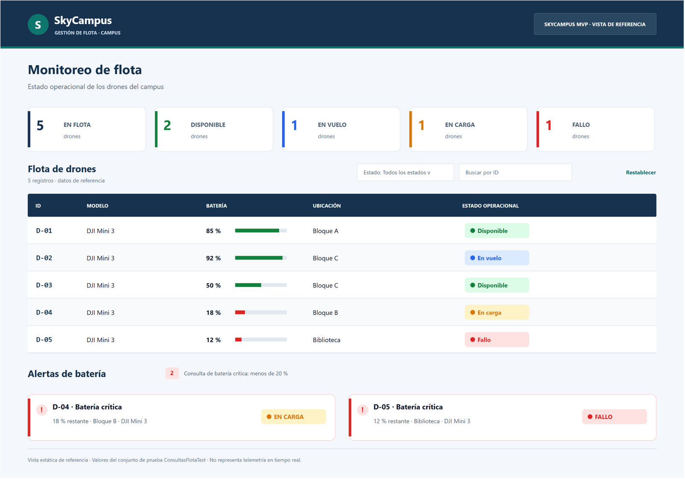

El archivo [panel-monitoreo.drawio](docs/ui/panel-monitoreo.drawio) permite inspeccionar y editar individualmente los elementos que componen esa captura. Se diseña una sola vista; los controles dibujados para filtrar, buscar o restablecer son affordances del mockup para evaluar el control del operador, no afirmaciones de que esas interacciones estén implementadas en el MVP.

Figma: https://www.figma.com/make/1bMJLQm8JGMjiOmmjvsoM3/Flota-panel-de-monitoreo?t=R4leihCl2nyEIWi0-1

## Análisis y validación con las heurísticas de Nielsen

La siguiente evaluación contrasta cinco heurísticas con evidencias localizables en la única vista del mockup. Se trata de una validación del diseño propuesto, no de una afirmación de que se hayan ejecutado pruebas con operadores.

## 1. Visibilidad del estado del sistema

### Cómo se aplica en el panel

El operador necesita reconocer la composición de la flota y la condición de cada dron sin deducirla ni cambiar de pantalla. Por eso, el resumen cuantifica los estados y la tabla presenta el estado actual de referencia junto con su batería y ubicación. La sección de alertas reúne los niveles inferiores al 20 % identificados por la consulta existente.

### Evidencia en el diseño

En la parte superior aparecen el total (5) y los contadores Disponibles (2), En vuelo (1), En carga (1) y Fallo (1). Las cinco filas indican batería y estado por nombre. En la zona «Alertas de batería» aparecen D-04 (18 %) y D-05 (12 %). La leyenda de referencia del panel aclara que los valores no son telemetría en tiempo real.

## 2. Control y libertad del usuario

### Cómo se aplica en el panel

La vista propone affordances visibles para acotar la tabla por estado, localizar un ID y restablecer la selección. «Todos los estados» representa una vista sin filtro; «Restablecer» sugiere una salida para regresar a ella. Esto da al operador una ruta de control reconocible sin ocultar de forma permanente el contexto de la flota.

### Evidencia en el diseño

Sobre la tabla se dibujan el selector «Todos los estados», el campo «Buscar por ID» y la acción «Restablecer». Están presentes como controles visuales en un mockup estático; no se atribuye al MVP una búsqueda, filtrado o interacción que el proyecto aún no implementa.

## 3. Consistencia y estándares

### Cómo se aplica en el panel

Un estado debe conservar su asociación semántica y cromática en toda la vista para que el operador no aprenda una codificación distinta por sección. Las etiquetas siguen los nombres del dominio, mientras que los colores diferencian de forma estable los cuatro estados. Los datos técnicos y los datos de lectura general también mantienen tratamientos tipográficos distintos.

### Evidencia en el diseño

Disponible siempre aparece en verde, En vuelo en azul, En carga en ámbar y Fallo en rojo, tanto en los contadores superiores como en las etiquetas de la tabla y las referencias dentro de las alertas. Cada color se acompaña de texto; los ID, como `D-01`, se componen en monoespaciada.

## 4. Prevención de errores

### Cómo se aplica en el panel

La interfaz evita confundir una batería baja con el estado operacional del dron: comunica ambos datos por separado y hace explícito el umbral usado para la alerta. Esta diferenciación reduce el riesgo de interpretar «En carga» como «Disponible» o de confundir la alerta de consulta con las reglas de asignación de una misión.

### Evidencia en el diseño

D-04 conserva la etiqueta En carga y D-05 la etiqueta Fallo, aunque ambos figuren en «Alertas de batería» por tener 18 % y 12 %, respectivamente. Cada fila muestra el porcentaje numérico y una barra. La leyenda especifica «inferior al 20 %», y el README diferencia ese umbral de asignación (30 % o 50 % para `LIBRO`). No se presenta la alerta como una decisión automática ni como autorización para asignar un dron.

## 5. Diseño estético y minimalista

### Cómo se aplica en el panel

El mockup prioriza las tareas informativas del operador: revisar el total, localizar un dron, comparar su condición y advertir niveles de batería críticos. No añade vistas o componentes que desplacen esa lectura ni incorpora capacidades futuras fuera del alcance.

### Evidencia en el diseño

Una sola página contiene encabezado, cinco contadores, una tabla con los cinco datos requeridos y una sección de alertas. El fondo y las tarjetas separan grupos; los bordes son discretos y las etiquetas de estado aparecen donde aportan información. No se incluyen mapa, telemetría en vivo, monitoreo remoto, IA ni automatizaciones.

### Resultado de la validación

El diseño aporta evidencia visual concreta para cinco heurísticas de Nielsen: la visibilidad se comprueba en contadores, estados por fila y alertas; el control y libertad, en los affordances explícitos de filtrar, buscar y restablecer, delimitados como propuesta visual; la consistencia, en la repetición de las cuatro combinaciones de estado y sus etiquetas; la prevención de errores, en la separación del estado operacional y la alerta de batería, con umbral explicado; y el minimalismo, en la organización de toda la información pertinente en una sola vista sin capacidades ajenas al MVP. Este resultado valida la cobertura de las heurísticas en el mockup; no sustituye pruebas de uso ni verifica el funcionamiento de controles estáticos.

# Reto Chimchar #10 - Organización del MVP en Jira

## Objetivo

Utilizamos Jira para planificar el MVP de SkyCampus y organizar el trabajo de forma que pudiéramos relacionar las necesidades del producto con las tareas necesarias para atenderlas. Esta herramienta nos permitió estructurar el alcance, dividirlo en unidades de trabajo comprensibles y facilitar su seguimiento durante la planificación ágil.

## Estructura utilizada

Organizamos el trabajo siguiendo la jerarquía **Épica → Feature → Historias de Usuario → Subtareas**:

- **Épica:** agrupamos bajo este nivel el objetivo amplio del MVP SkyCampus para mantener una visión general del producto.
- **Feature:** usamos este nivel para delimitar una capacidad funcional que contribuye a la épica y agrupa historias relacionadas.
- **Historias de Usuario:** expresamos necesidades desde la perspectiva de un rol y el valor que espera obtener, para orientar el trabajo hacia las personas usuarias.
- **Subtareas:** desglosamos el trabajo técnico asociado a las historias en actividades más pequeñas, que ayudan a identificar qué se requiere para implementarlas.

## Trabajo realizado

Realizamos manualmente en Jira la organización del MVP: creamos una épica para SkyCampus y una feature relacionada con la gestión de la flota. A partir de esta organización, redactamos historias de usuario con el formato **«Como [rol], quiero [acción], para [beneficio]»** y asociamos subtareas técnicas para desglosar el trabajo necesario.

Las capturas de Jira se incluyen como evidencia de los elementos organizados y permiten consultar los detalles registrados manualmente en el tablero.

## Criterios de aceptación

Consideramos los criterios de aceptación como una guía para dejar claro cuándo una historia satisface la necesidad planteada. Al redactarlos, procuramos que:

- describan resultados observables relacionados con la historia de usuario;
- sean claros y verificables, evitando expresiones ambiguas;
- indiquen las condiciones relevantes para considerar atendida la necesidad;
- permitan al equipo revisar el alcance esperado sin asumir que una tarea ya fue implementada o probada.

La inclusión de estos criterios sirve para orientar la planificación y la validación posterior; no afirmamos aquí resultados de ejecución ni de pruebas.

## Evidencias

Las siguientes capturas documentan la organización del MVP en Jira:

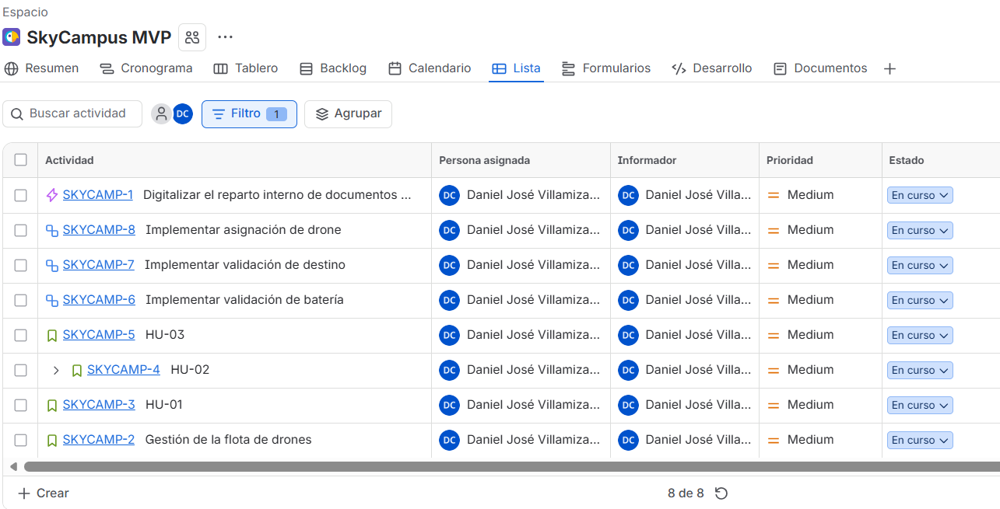
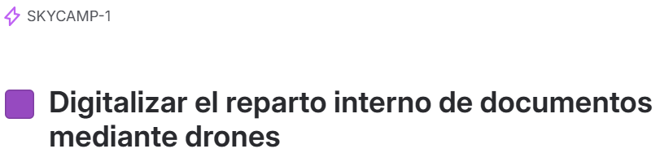
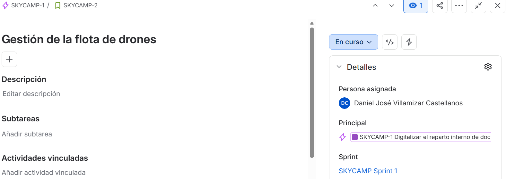
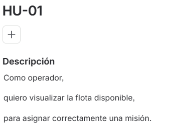
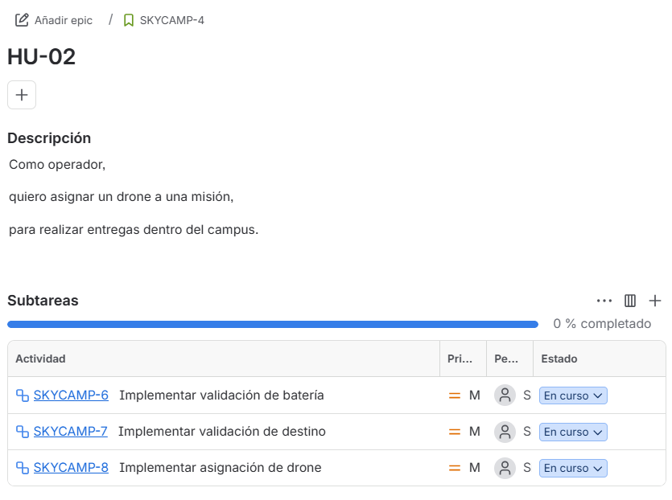
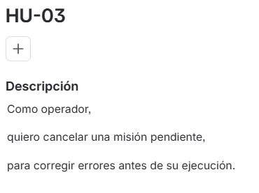
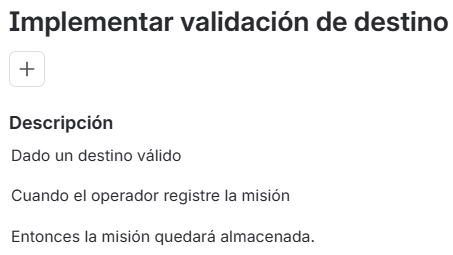
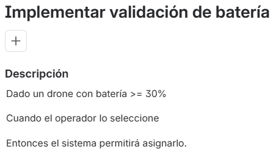

# Reto Chimchar #11 - Diagrama de Casos de Uso

El diagrama delimita **SkyCampus MVP** y representa el caso central SC-01, Registrar misión de reparto, junto con las consultas y responsabilidades administrativas requeridas para el MVP. Los actores son externos al límite del sistema y las relaciones muestran las interacciones con los casos de uso.

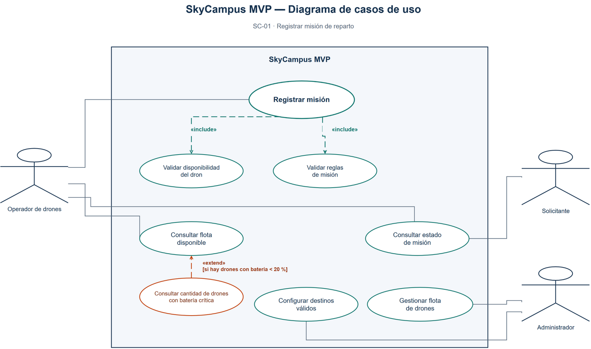

Fuente editable: [cu-skycampus.drawio](docs/use-cases/cu-skycampus.drawio). Exportación PNG: [cu-skycampus.png](docs/use-cases/cu-skycampus.png).

## Actores identificados

- **Operador de drones:** registra misiones, consulta la flota disponible y revisa el estado de una misión.
- **Solicitante:** consulta el estado de la misión asociada a su solicitud.
- **Administrador:** configura los destinos válidos y gestiona la flota de drones.

Los tres actores se muestran fuera del rectángulo de SkyCampus porque representan roles que interactúan con el sistema, no componentes internos.

## Casos de uso principales

- **Registrar misión:** es el objetivo de SC-01. El registro selecciona un dron disponible y solo puede confirmarse si se cumplen las reglas de la misión.
- **Consultar flota disponible:** permite al operador identificar los drones disponibles; corresponde a la consulta de candidatos implementada en el dominio.
- **Consultar estado de misión:** permite consultar el estado registrado de una misión.
- **Configurar destinos válidos** y **Gestionar flota de drones:** representan las responsabilidades administrativas indicadas para el MVP, sin añadir operaciones, pantallas ni reglas administrativas que no estén especificadas.
- **Validar disponibilidad del dron** y **Validar reglas de misión:** expresan las comprobaciones obligatorias del flujo de registro. Las reglas existentes incluyen batería mínima según el tipo de carga y pertenencia del destino al catálogo del campus.
- **Consultar cantidad de drones con batería crítica:** representa el conteo disponible en la consulta de flota; no implica el envío de una alerta automática.

El MVP se implementa como lógica de dominio local, sin presuponer interfaz gráfica ni servicio de red. El catálogo de destinos vigente es fijo en el validador; el caso administrativo se muestra al nivel de responsabilidad exigido, sin afirmar que ya exista una interfaz para modificarlo.

## Relación «include»

**Registrar misión** incluye **Validar disponibilidad del dron** y **Validar reglas de misión**. Son comportamientos obligatorios: el registro requiere que la estrategia encuentre un dron disponible y que la misión satisfaga las validaciones de batería y destino antes de guardarse.

## Relación «extend»

**Consultar cantidad de drones con batería crítica** extiende **Consultar flota disponible** únicamente cuando hay drones con batería inferior al 20 %. La condición corresponde al umbral que usa la consulta existente para contar baterías críticas. La extensión no representa una notificación automática ni cambia los umbrales de validación de SC-01.

## Justificación del modelo

El diagrama centra el flujo en SC-01 y separa sus comprobaciones obligatorias de las consultas que pueden realizar los actores. Conserva los roles y casos de uso solicitados, reutiliza las reglas y consultas presentes en Chimchar y limita la extensión a la condición de batería crítica que el dominio ya contempla. No presupone interfaces, integraciones ni automatizaciones, y presenta las responsabilidades administrativas únicamente con el alcance establecido para el MVP.

# Reto Chimchar #12 - Diseño asistido por IA

## Objetivo

Validar conceptualmente el diseño visual del panel de monitoreo de SkyCampus utilizando IA generativa como apoyo para explorar alternativas en una etapa temprana. La revisión se centra en la claridad de la información operativa y en cómo el operador podría reconocer el estado de la flota; no constituye una implementación funcional ni una validación con usuarios.

## Proceso seguido

1. **Investigación de referencias visuales:** se revisaron referencias de paneles de monitoreo y tableros operativos para orientar la organización de la información y la jerarquía visual.
2. **Uso del manual de identidad:** se tomó como guía el [manual de identidad visual](docs/ui/manual-identidad.md), incluyendo la paleta, la tipografía, el tono y la representación textual y cromática de los estados.
3. **Extracción de información del RF SC-01:** se consultaron los requisitos de validación de una misión (RF-01) y el caso de uso de registro de misión (SC-01) para reconocer las reglas y los datos del dominio pertinentes. Se mantuvieron diferenciados los umbrales de batería para asignación de misiones y el umbral de batería crítica usado en la consulta de flota.
4. **Construcción de prompts detallados:** se estructuraron instrucciones para orientar las propuestas con el propósito del panel, la identidad de SkyCampus, los datos que debían visualizarse y los estados que se querían explorar.
5. **Generación de propuestas visuales:** se exploraron propuestas visuales con IA generativa como apoyo para revisar distintas representaciones del panel. Las imágenes disponibles se adjuntan en la sección de evidencias; no se atribuyen a la IA resultados que no estén documentados.

## Diseño evaluado

La evaluación se enfocó en la representación de los elementos necesarios para comprender la flota y apoyar la tarea del operador:

- Estado operacional de los drones, con etiquetas comprensibles.
- Ubicación de cada dron dentro del campus.
- Nivel de batería expresado numéricamente.
- Alertas que destaquen condiciones que requieren atención y su criterio.
- Acciones disponibles para el operador, presentadas de forma reconocible y coherente con el alcance del sistema.

Se consideraron tres situaciones para organizar la revisión de las propuestas: una vista normal de la flota, una situación con alerta y una vista sin drones disponibles. Hay imágenes disponibles para los dos primeros escenarios; la evidencia de la vista sin drones disponibles queda pendiente.

## Heurísticas de Nielsen consideradas

Durante la construcción del mockup se consideraron las siguientes heurísticas como criterios para revisar la legibilidad y el uso del panel:

- **Visibilidad del estado del sistema:** comprobar si el estado operacional, la batería y las alertas se distinguen con facilidad.
- **Correspondencia entre el sistema y el mundo real:** usar nombres de estados y ubicaciones que tengan sentido para la operación de SkyCampus.
- **Control y libertad del usuario:** revisar si las acciones del operador se identifican claramente y si la vista comunica cómo continuar ante los escenarios representados.
- **Consistencia y estándares:** mantener una presentación uniforme para estados, etiquetas, datos y acciones.
- **Prevención de errores:** diferenciar las alertas de batería de las reglas de asignación de misiones para evitar interpretaciones incorrectas.
- **Reconocimiento antes que recuerdo:** presentar los datos de flota necesarios en la vista, sin depender de que el operador recuerde información de otra pantalla.
- **Diseño estético y minimalista:** priorizar la información pertinente para el monitoreo y evitar elementos que distraigan de ella.

Estos criterios orientan la revisión visual; no implican que se haya realizado una prueba de usabilidad con operadores.

## Prompt utilizado

### Prompt

[Pegar prompt utilizado aquí]

## Evidencias

### Estado normal

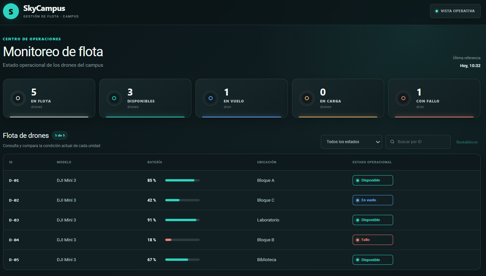

### Estado de alerta

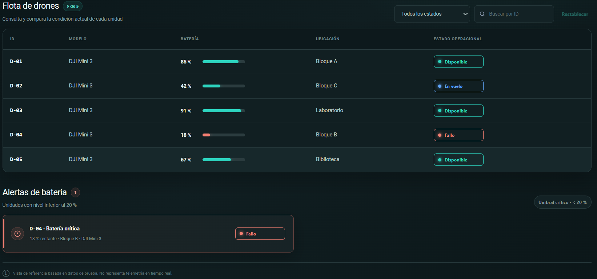

### Estado sin drones disponibles

[Insertar imagen aquí]

## Análisis

Documentar aquí las observaciones al revisar las propuestas: claridad de la información, consistencia con el manual de identidad, facilidad para identificar alertas y acciones, diferencias entre alternativas y ajustes que convendría realizar. Registrar únicamente observaciones que puedan verificarse en las evidencias incorporadas.

## Conclusiones

La IA generativa puede servir como herramienta de apoyo en etapas tempranas de diseño: ayuda a explorar enfoques visuales y a hacer más concreta la conversación sobre jerarquía, estados y necesidades del operador. Sus propuestas deben contrastarse con los requisitos, las reglas del dominio y la identidad visual del proyecto. La herramienta no sustituye el criterio del equipo ni la validación con usuarios, y cualquier observación sobre una propuesta debe sustentarse en una evidencia disponible.

# Reto Chimchar #13 - TDD

Este informe describe el proceso de implementación de `ValidadorMision` mediante desarrollo guiado por pruebas (Test-Driven Development, TDD). El trabajo se organizó en ciclos de Red, Green y Refactor: primero se definieron los comportamientos esperados, después se añadió la implementación mínima para satisfacerlos y, finalmente, se mejoró la organización del código sin alterar lo que observan sus usuarios.

## Red

Antes de implementar la lógica de `ValidadorMision`, se plantearon pruebas para especificar el comportamiento de sus tres operaciones: `tieneBateriaSuficiente`, `validarDestino` y `droneEstaDisponible`. En conjunto, los casos comprueban tanto situaciones válidas como límites y entradas no válidas: batería en el mínimo requerido, batería por debajo del mínimo y dron nulo; un destino reconocido, uno desconocido y un destino nulo; y drones disponibles, en otros estados operativos o nulos.

Al ejecutarse en esta primera etapa, las pruebas fallaban porque la funcionalidad todavía no existía: no se contaba con la implementación de `ValidadorMision` y sus reglas. El fallo inicial era, por tanto, el resultado esperado de la etapa Red: las pruebas expresaban el contrato pendiente de cumplir y hacían visibles los comportamientos necesarios antes de escribir el código.

## Green

Para pasar a Green se implementó únicamente la lógica necesaria para satisfacer ese contrato. `tieneBateriaSuficiente` verifica que el dron exista y alcance el umbral mínimo de batería del 30 %. `validarDestino` acepta los destinos presentes en el catálogo del campus y lanza `DestinoInvalidoException` cuando recibe un destino nulo o desconocido. `droneEstaDisponible` comprueba que el dron exista y que su estado permita utilizarlo.

Con esta implementación mínima, cada prueba pudo ejecutarse contra las reglas correspondientes. Mantener el alcance acotado a los comportamientos descritos por las pruebas permitió avanzar sin añadir funcionalidades ajenas al validador.

## Refactor

Una vez satisfechas las pruebas, el código se organizó para hacer más claras y consistentes las reglas. El umbral de batería se expresa mediante la constante `BATERIA_MINIMA`, y el catálogo de destinos se centraliza en una colección inmutable. Además, las comprobaciones de nulidad quedan explícitas en los métodos que reciben drones o destinos. Estos cambios mejoran la legibilidad y reducen la dispersión de valores y reglas, pero conservan el comportamiento observable: para las mismas entradas se mantienen los mismos resultados y excepciones.

## Patrón AAA

El patrón AAA estructura una prueba en tres momentos:

- **Arrange (Preparar):** se construyen los datos necesarios y se establece el contexto de la prueba.
- **Act (Actuar):** se ejecuta el método cuyo comportamiento se quiere verificar.
- **Assert (Comprobar):** se contrasta el resultado obtenido con el esperado.

El siguiente caso está tomado de `ValidadorMisionTest`:

```java
@Test
void bateriaDeTreintaPorCientoEsSuficiente() {
    assertTrue(validador.tieneBateriaSuficiente(drone(30, EstadoDrone.DISPONIBLE)));
}
```

En **Arrange**, `setUp` prepara una instancia de `ValidadorMision` antes de cada prueba y `drone(30, EstadoDrone.DISPONIBLE)` proporciona un dron con la batería en el mínimo. En **Act**, se invoca `tieneBateriaSuficiente` con ese dron. En **Assert**, `assertTrue` comprueba que el validador lo considere suficiente. El ejemplo muestra que las tres fases pueden identificarse en una prueba concisa, aunque la preparación y la ejecución estén escritas dentro de la misma expresión.

## Resultado

La ejecución de la suite de `ValidadorMisionTest` reportó **11 pruebas ejecutadas y 0 fallos**. Los métodos cubiertos por estos casos son `tieneBateriaSuficiente`, `validarDestino` y `droneEstaDisponible`. La variedad de entradas comprobadas respalda tanto los resultados positivos como el manejo de límites, estados no disponibles y valores nulos definidos para el validador.

# Reto Chimchar #14 - Calidad de Código

Este reto revisa la cobertura de pruebas con JaCoCo y el estado de calidad estática con SonarQube. La revisión priorizó conservar las reglas del dominio y corregir únicamente los problemas sustentados por los reportes, sin retirar lógica productiva para mejorar métricas.

## Cobertura inicial

Antes de ampliar las pruebas, `mvn verify` ejecutó 65 pruebas sin fallos. El reporte inicial de JaCoCo ya superaba el umbral solicitado: **100 % de cobertura de instrucciones, líneas y ramas**. En el resumen se analizaron 891 instrucciones, 198 líneas, 126 ramas y 22 clases; no había elementos sin cubrir. Por esta razón no se añadió lógica artificial ni se modificó el código de producción para perseguir un porcentaje mayor.

## Cobertura final

Se añadieron seis casos para comprobar `valueOf()` en los tres enums: la resolución de un valor existente y el rechazo de un nombre desconocido. La suite final ejecuta **71 pruebas, con 0 fallos**. JaCoCo conserva **100 % de cobertura de instrucciones, líneas y ramas**, con 891 instrucciones cubiertas, 198 líneas cubiertas y 126 ramas cubiertas en 22 clases.

Los tests existentes, revisados junto con JaCoCo, también cubren las validaciones solicitadas para `Drone` y `Mision`, la construcción y los errores del `MisionBuilder`, ambas estrategias de asignación y las aprobaciones y rechazos de la cadena por batería, destino y carga. El reporte HTML generado queda en `target/site/jacoco/index.html`; la exportación XML para SonarQube está en `target/site/jacoco/jacoco.xml`.

## Hallazgos SonarQube

Se ejecutó el análisis disponible en SonarQube for IDE sobre los archivos fuente Java de producción. La vista de problemas reportó dos Code Smells en `ConsultasFlota`; después de corregirlos, la revisión del IDE no mostró problemas pendientes.

### Bugs encontrados

El análisis local disponible no reportó bugs. La revisión se limitó a los diagnósticos del análisis por archivo en el IDE; no se recibió un informe de Quality Gate de SonarQube Server o SonarQube Cloud.

### Vulnerabilities encontradas

El análisis local disponible no presentó vulnerabilidades en la vista de problemas. Sin embargo, el reporte de Security Hotspots y taint vulnerabilities de SonarQube requiere Connected Mode. No fue posible obtenerlo: no hay un servidor respondiendo en `http://localhost:9000` y el workspace no está enlazado a un proyecto remoto. Por lo tanto, no se afirma que el contador de vulnerabilidades abiertas del servidor sea cero; esa verificación queda pendiente de ejecutar con una instancia conectada.

### Code Smells encontrados

SonarQube for IDE señaló dos usos de `Collectors.toList()` en `ConsultasFlota`: uno al obtener los identificadores disponibles y otro al generar el resumen de batería. El impacto era de mantenibilidad y consistencia con las API actuales de Stream, no de una regla de negocio incorrecta. Se reemplazaron por `Stream.toList()` y se envolvieron los resultados en `ArrayList`, conservando la capacidad de modificación que tenían las listas devueltas por la implementación previa.

Para preparar un análisis con SonarQube Scanner se añadió `sonar-project.properties`, con las rutas de fuentes, tests, clases compiladas y el reporte XML de JaCoCo. Con un servidor SonarQube local disponible, los comandos son:

```bash
mvn verify
sonar-scanner -Dsonar.host.url=http://localhost:9000
```

El scanner requiere que la instancia de SonarQube esté iniciada y que la autenticación, si aplica, se configure de forma segura fuera del repositorio. En este entorno no están instalados `sonar-scanner` ni un servidor local, de modo que no se pudo ejecutar el análisis de servidor ni producir una captura real de su dashboard.

## Refactorizaciones realizadas

- Se actualizaron dos operaciones de Stream en `ConsultasFlota` para usar `toList()`. El envoltorio con `ArrayList` mantiene las listas modificables y preserva el contenido y el orden de los resultados.
- Se añadieron pruebas de éxito y error para `valueOf()` de `EstadoDrone`, `EstadoMision` y `TipoCarga`, sin alterar los enums.
- No se eliminó lógica productiva. Los resultados funcionales de las consultas y las reglas de validación permanecen iguales.

## Evidencias

- Captura del resumen de JaCoCo: [docs/quality/captura-jacoco.png](docs/quality/captura-jacoco.png).
- Reporte HTML completo: [target/site/jacoco/index.html](target/site/jacoco/index.html).
- Captura de SonarQube: pendiente; no hay dashboard de servidor disponible en este entorno. No se añadió una imagen sustitutiva para evitar presentar como evidencia una captura que no provenga de un análisis real.
