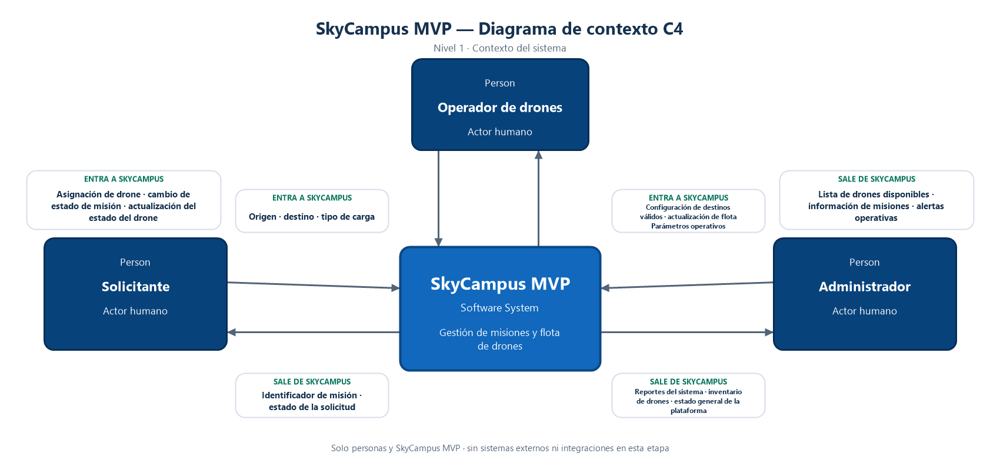

# SkyCampus — Refuerzo DOSW

Proyecto MVP del sistema de reparto de drones


## Requisitos

- JDK 21 o posterior.
- Maven 3.9 o posterior.

## Estructura

```text
src/
├── main/java/co/edu/escuelaing/skycampus/
│   ├── domain/         # Drone y Mision
│   ├── enumeration/    # Estados de misión y tipos de carga
│   └── service/        # Reglas de validación de misión
└── test/java/          # Pruebas unitarias con JUnit 5
```

JUnit 5 y Mockito están configurados como dependencias de prueba. JaCoCo
genera el reporte de cobertura.

## Comandos

```bash
mvn test
mvn verify
```

El reporte HTML de JaCoCo queda en `target/site/jacoco/index.html`.

## Reto Chimchar #1 - Streams y Lambdas

### Objetivo

El objetivo de este reto es consultar una flota de drones para ayudar al operador a decidir cuáles pueden recibir una misión, conocer la distribución de la batería y revisar la ubicación de los equipos. La solución se adaptó al modelo vigente del proyecto: la disponibilidad se obtiene desde `EstadoDrone.DISPONIBLE`, en lugar de almacenarse como un booleano independiente.

### Solución implementada

La clase `ConsultasFlota`, ubicada en `src/main/java/co/edu/escuelaing/skycampus/service/ConsultasFlota.java`, agrupa las cuatro consultas sobre una lista de `Drone`. Cada método inicia un Stream desde la flota y compone las operaciones necesarias para producir el resultado, sin ciclos `for`, `foreach` ni iteradores explícitos.

La primera consulta filtra los drones cuyo estado es disponible y cuya batería es al menos del 50 %. Luego ordena los drones por batería de mayor a menor, proyecta cada objeto a su identificador y recolecta los identificadores en una lista. Ordenar antes de aplicar `map` permite comparar la batería, que no forma parte del resultado final.

La segunda consulta busca si hay algún dron disponible en la ubicación indicada. Para ello usa `anyMatch`, cuya condición comprueba conjuntamente el estado y la ubicación; devuelve `true` al encontrar una coincidencia y `false` si termina la búsqueda sin encontrarla.

La tercera consulta filtra los drones con batería menor al 20 % y aplica `count` al resultado. No filtra por estado, por lo que cuenta los equipos en condición crítica independientemente de que estén disponibles, volando, cargándose o en fallo.

La cuarta consulta usa `map` para transformar cada dron en una cadena con el formato `ID: batería%` y recolecta las cadenas en una lista. Conserva el orden de la flota recibida y representa todos sus elementos, sin importar el estado.

Las pruebas de `ConsultasFlotaTest` verifican los resultados concretos de las cuatro consultas. La flota de prueba incluye drones en los cuatro estados del dominio, diferentes niveles de batería y ubicaciones para comprobar tanto las condiciones de filtrado como el orden esperado.

### Operaciones de Stream utilizadas

`filter` es una operación intermedia que conserva los elementos que cumplen un predicado. Se usa para seleccionar drones disponibles con batería suficiente en la primera consulta y para identificar baterías críticas en la tercera.

`sorted` es una operación intermedia que ordena los elementos de acuerdo con un comparador. En la primera consulta permite mostrar primero los drones con más batería, que son los candidatos preferentes entre los que cumplen el mínimo.

`map` es una operación intermedia que transforma cada elemento sin cambiar el tamaño del flujo. Se utiliza para convertir los drones en IDs o en cadenas de resumen, de modo que las listas resultantes contengan solo la información pedida.

`anyMatch` es una operación terminal que evalúa si al menos un elemento satisface una condición. Resulta adecuada para responder la pregunta de existencia de un dron disponible en una ubicación y puede detener la evaluación tan pronto encuentra una coincidencia.

`count` es una operación terminal que devuelve cuántos elementos quedaron en el flujo. Permite obtener el total de drones con batería crítica sin crear una colección intermedia.

`collect(Collectors.toList())` es una operación terminal que materializa los elementos del flujo en una lista. Se usa donde el resultado solicitado es una colección de IDs o de cadenas con el nivel de batería.

### Conceptos y reflexión

Una operación intermedia configura una transformación del flujo, como filtrar, ordenar o convertir elementos, y devuelve otro Stream. Las operaciones intermedias son perezosas: por sí solas no recorren la colección ni producen el resultado final; sus transformaciones se ejecutan cuando una operación terminal las necesita.

Una operación terminal consume el flujo y produce un resultado que ya no es otro Stream. En esta solución, `collect`, `count` y `anyMatch` son terminales: respectivamente construyen listas, calculan una cantidad y contestan una condición de existencia. Cada consulta completa su pipeline con una de estas operaciones.

Un Stream solo puede consumirse una vez porque representa una secuencia de operaciones sobre una fuente, no una colección de resultados reutilizable. Después de ejecutar una operación terminal, el flujo queda cerrado; intentar invocar otra operación sobre ese mismo Stream produce un error. Si se necesita realizar otra consulta, se crea un nuevo Stream desde la colección original, como hace cada método de `ConsultasFlota`.

Para este problema, Streams resulta más expresivo que recorrer colecciones con ciclos tradicionales porque permite describir directamente la intención de cada consulta: filtrar candidatos, ordenarlos, proyectar los datos solicitados, comprobar una existencia o contar resultados. Esa composición separa el “qué” se quiere obtener de los detalles del recorrido y reduce el manejo manual de listas temporales y acumuladores. Los ciclos siguen siendo útiles en otros contextos, pero aquí el pipeline hace visibles las reglas del dominio en el orden en que se aplican.

# Reto Chimchar #3 - Patrones de Diseño

## Builder

### Problema identificado

Una misión agrupa varios datos relacionados: identificador, drone, origen, destino, tipo de carga y estado. Construirla directamente requiere recordar el orden de los argumentos del constructor y pasar todos los valores en una sola expresión, lo que dificulta la lectura y aumenta el riesgo de confundir campos o dejar datos obligatorios sin especificar.

### Patrón seleccionado

Se seleccionó el patrón Builder para separar la configuración progresiva de una misión de su construcción final.

### Justificación

El Builder ofrece una interfaz fluida cuyos métodos describen cada campo por su nombre. De esta manera, la intención de quien crea la misión queda visible en el código y se pueden agregar o cambiar valores sin depender del orden de parámetros de un constructor largo. También concentra la validación de los datos requeridos en el punto de construcción.

### Implementación en SkyCampus

La clase `MisionBuilder`, en el paquete de dominio, expone los métodos `id`, `drone`, `origen`, `destino`, `tipoCarga` y `estado`. Cada método devuelve el mismo builder para permitir encadenar llamadas. Antes de construir la instancia, `build()` comprueba que los campos obligatorios estén presentes y lanza `IllegalStateException` si falta alguno. La misión resultante sigue siendo el `record` inmutable `Mision`, por lo que el patrón no cambia las garantías existentes del modelo.

### Ventajas obtenidas

La creación de misiones es más legible y menos propensa a errores de orden, mientras que la responsabilidad de validar la construcción queda claramente localizada. Las pruebas pueden comprobar individualmente cada dato ausente y la construcción válida sin modificar la inmutabilidad ni la API existente de `Mision`.

## Chain of Responsibility

### Problema identificado

Antes de ejecutar una misión, SkyCampus debe revisar varias reglas independientes: la batería del drone, que el destino pertenezca al campus y que la carga sea compatible con las condiciones de vuelo. Si esas reglas se mezclan en un único método, agregar o modificar una validación obliga a alterar un bloque central y puede dificultar el aislamiento de cada causa de rechazo.

### Patrón seleccionado

Se seleccionó Chain of Responsibility para organizar las validaciones en una secuencia de componentes que procesan la misión y delegan el trabajo al siguiente eslabón.

### Justificación

Cada validador encapsula una sola regla de negocio y la cadena se detiene en el primer error, comunicando explícitamente por qué la misión no puede continuar. El orden se mantiene deliberado: primero se descartan drones con batería inferior al 30 %, luego se verifica el destino mediante la lógica preexistente y finalmente se comprueba la regla de carga. Así se reutilizan las reglas actuales y se evita evaluar condiciones posteriores cuando ya existe una falla.

### Implementación en SkyCampus

`ValidadorMisionChain` define el procesamiento común y permite delegar a un siguiente validador. Su fábrica `crearCadena()` configura el orden `ValidadorBateria`, `ValidadorDestino` y `ValidadorCarga`. El validador de destino delega la decisión a `ValidadorMision.validarDestino`, que conserva el catálogo vigente del campus. La regla de capacidad documentada para Chimchar permite sobres y carpetas desde el mínimo general de 30 %, mientras que exige al menos 50 % para transportar libros.

### Ventajas obtenidas

Las reglas quedan separadas, el orden de ejecución resulta explícito y cada fallo puede probarse de manera aislada a través de la cadena. La reutilización del validador de destinos evita duplicar el catálogo existente, y futuras reglas pueden incorporarse como eslabones sin concentrar la lógica en un único método.

## Strategy

### Problema identificado

La asignación de un drone disponible puede responder a distintas políticas operativas. Elegir siempre el mismo criterio acoplaría la decisión a quien solicita la asignación y haría más difícil comparar o reemplazar políticas sin modificar el código cliente.

### Patrón seleccionado

Se seleccionó Strategy para representar la selección de un drone como una política intercambiable.

### Justificación

El patrón define una interfaz común para varias formas de resolver la misma decisión. El código que necesita asignar un drone puede trabajar con la abstracción sin conocer cómo se ordenan o recorren los candidatos. Esto permite variar la política de forma localizada y comprobar que cada criterio se comporte según lo esperado.

### Implementación en SkyCampus

`EstrategiaAsignacionDrone` define `seleccionar(List<Drone>)`. `AsignacionMayorBateriaStrategy` filtra los drones disponibles y elige el de batería más alta, mientras que `AsignacionPrimerDisponibleStrategy` conserva el orden de entrada y selecciona el primer drone disponible. Ambas estrategias rechazan listas nulas y notifican con `IllegalStateException` cuando no hay candidatos disponibles.

### Ventajas obtenidas

Las políticas de asignación pueden reemplazarse sin alterar sus consumidores ni el modelo `Drone`, y añadir otra política no requiere cambiar las implementaciones existentes. Las pruebas verifican los criterios concretos, la exclusión de drones no disponibles y los casos sin candidatos, lo que hace más confiable la evolución de la asignación.

# Reto Chimchar #5 - Principios SOLID

## Análisis de los principios

### SRP — Principio de responsabilidad única

**Qué significa el principio.** El principio de responsabilidad única establece que una clase debe tener un único motivo para cambiar. Esto no implica que una clase solo pueda ejecutar una operación, sino que sus operaciones deben responder a una misma responsabilidad coherente dentro del sistema.

**Cómo se incumple en el GestorDrone mostrado en el reto.** Un `GestorDrone` que selecciona drones, registra misiones, calcula rutas, notifica al operador y construye reportes reúne decisiones de negocio y tareas de presentación en un único componente. Cada una de esas actividades cambia por razones distintas: una nueva regla de asignación, una modificación del formato del reporte o una forma diferente de alertar al operador obligaría a modificar la misma clase.

**Consecuencias del problema.** La acumulación de responsabilidades aumenta el acoplamiento y dificulta comprender y probar el componente. Un cambio localizado puede afectar una función que no guarda relación directa con él, y las pruebas unitarias terminan configurando más dependencias de las que exige el comportamiento bajo evaluación.

**Cómo se corrige en SkyCampus.** La asignación se concentra en `AsignadorMision`, la representación textual en `GeneradorReporte` y el cálculo de trayectos en `ServicioRuta`. De este modo cada clase responde a una responsabilidad identificable y puede probarse de forma independiente. La consulta de flota ya existente conserva su propio propósito y no se fusiona con estas nuevas funciones.

### OCP — Principio abierto/cerrado

**Qué significa el principio.** El principio abierto/cerrado propone que los componentes estén abiertos a la extensión de su comportamiento y cerrados a la modificación repetida de la lógica estable. En lugar de editar un bloque central cada vez que aparece una variante, se incorpora una implementación que cumple un contrato conocido.

**Cómo se incumple en el GestorDrone mostrado en el reto.** Si el gestor decide la ruta con una cadena de condiciones `if/else` que distingue entre trayecto directo, presencia de obstáculos u otras circunstancias, agregar una política de vuelo requiere reabrir ese método e introducir otra condición. Con el tiempo, las reglas de selección se mezclan y es más probable que una modificación altere las rutas existentes.

**Consecuencias del problema.** Las decisiones se vuelven más difíciles de aislar y verificar; el componente crece con cada política y el riesgo de regresiones aumenta. Además, resulta necesario modificar y volver a probar la misma clase aun cuando la funcionalidad nueva podría representarse de manera independiente.

**Cómo se corrige en SkyCampus.** `ServicioRuta` recibe una `EstrategiaRuta` mediante el constructor y delega en ella el cálculo. `RutaDirectaStrategy` y `RutaEvitarObstaculosStrategy` muestran dos políticas intercambiables; una estrategia nueva puede implementarse e inyectarse sin modificar `ServicioRuta`. La prueba con una estrategia adicional verifica esa posibilidad de extensión.

### LSP — Principio de sustitución de Liskov

**Qué significa el principio.** El principio de sustitución de Liskov requiere que cualquier implementación o subtipo pueda ocupar el lugar de la abstracción que cumple sin romper las expectativas del cliente ni debilitar las garantías de comportamiento establecidas por el contrato.

**Cómo se incumple en el GestorDrone mostrado en el reto.** Una clase concreta con condicionales no presenta por sí misma una jerarquía de tipos sustituibles. Sin embargo, si las políticas de ruta se convierten en subtipos de una abstracción común y alguna implementación, por ejemplo, devuelve una ruta vacía para extremos válidos o altera el significado de origen y destino, esa implementación incumpliría las expectativas de quienes usan la abstracción.

**Consecuencias del problema.** Una sustitución que rompe el contrato causa errores dependientes de la implementación y obliga al consumidor a conocer detalles concretos para evitar rutas inválidas. En ese escenario, la abstracción deja de permitir el intercambio seguro de políticas.

**Cómo se corrige en SkyCampus.** En el diseño actual, LSP sí aplica a las implementaciones de `EstrategiaRuta`: `ServicioRuta` acepta cualquiera de ellas y valida que entregue al menos origen y destino, en el orden solicitado, sin puntos vacíos. Las estrategias directa y con punto intermedio respetan ese comportamiento. Una implementación que incumpla el contrato se rechaza explícitamente. LSP no se presenta como una violación preexistente demostrada en el `GestorDrone` procedural del reto, pues este no define por sí mismo una jerarquía sustituible; se hace relevante en la abstracción polimórfica incorporada para las rutas.

### ISP — Principio de segregación de interfaces

**Qué significa el principio.** El principio de segregación de interfaces recomienda definir contratos pequeños y orientados al rol de cada consumidor. Los clientes no deberían depender de operaciones que no necesitan para cumplir su responsabilidad.

**Cómo se incumple en el GestorDrone mostrado en el reto.** Si el gestor o un servicio depende de una interfaz amplia que agrupa persistencia, alertas, rutas y reportes, cada consumidor queda expuesto a operaciones ajenas a su tarea. Por ejemplo, el componente que notifica una asignación no debería necesitar conocer cómo se genera un informe, y quien genera el informe no requiere enviar alertas.

**Consecuencias del problema.** Las interfaces amplias obligan a implementaciones de prueba a proveer métodos irrelevantes y acoplan cambios independientes entre sí. Por ello, una nueva operación del contrato puede afectar a consumidores que no la utilizan.

**Cómo se corrige en SkyCampus.** `AlertaOperador` expone únicamente la notificación de asignación, mientras que `EstrategiaRuta` representa solo el cálculo de rutas. `RepositorioMision` agrupa las operaciones cohesivas de guardar y consultar por identificador, que necesita el asignador para evitar duplicados y persistir la misión. Así, cada colaborador recibe contratos relacionados con su función, en lugar de una interfaz de gestor omnipotente.

### DIP — Principio de inversión de dependencias

**Qué significa el principio.** El principio de inversión de dependencias indica que la lógica de aplicación no debe quedar acoplada directamente a detalles de infraestructura. Tanto la política de alto nivel como sus implementaciones concretas deben relacionarse mediante abstracciones estables.

**Cómo se incumple en el GestorDrone mostrado en el reto.** Si el gestor instancia directamente un repositorio concreto, escribe las alertas en una consola específica o calcula las rutas por medio de una clase fija, una decisión de infraestructura queda incrustada en la lógica de asignación. Reemplazar almacenamiento o notificaciones exigiría cambiar el gestor.

**Consecuencias del problema.** La aplicación se vuelve difícil de adaptar y probar sin los componentes concretos. Las pruebas dependen de efectos secundarios reales o de configuraciones innecesarias, y las variaciones de infraestructura se propagan al código de negocio.

**Cómo se corrige en SkyCampus.** `AsignadorMision` recibe `EstrategiaAsignacionDrone`, `RepositorioMision` y `AlertaOperador` por constructor, y `ServicioRuta` recibe `EstrategiaRuta`. `RepositorioMemoria` es una implementación sencilla del contrato de persistencia, mientras que `RepositorioMock`, ubicado en el código de pruebas, permite verificar la colaboración sin acoplar los servicios a almacenamiento concreto. Las dependencias de construcción quedan explícitas y pueden sustituirse durante las pruebas.

## Violaciones encontradas

El diseño de un `GestorDrone` que reúna asignación, persistencia, notificaciones, rutas e informes violaría SRP porque las reglas de negocio y de presentación tendrían motivos distintos para cambiar. La separación introducida en SkyCampus distribuye esas tareas entre `AsignadorMision`, `GeneradorReporte` y `ServicioRuta`; `AlertaOperadorConsola` se ocupa únicamente de comunicar la asignación.

OCP se violaría si la elección de una ruta dependiera de un `if/else` fijo dentro de `ServicioRuta`: cada política nueva exigiría modificar la misma lógica. La dependencia en `EstrategiaRuta` evita ese cambio y permite agregar estrategias compatibles. De manera análoga, una interfaz única con métodos de cálculo, almacenamiento, notificación y generación de informes violaría ISP, pues los consumidores dependerían de operaciones que no utilizan. Los contratos enfocados `EstrategiaRuta`, `AlertaOperador` y `RepositorioMision` limitan esa exposición; el repositorio solo agrupa guardar y buscar por identificador, operaciones necesarias para evitar duplicados y persistir misiones durante la asignación.

DIP se violaría si `AsignadorMision` construyera directamente `RepositorioMemoria` o `AlertaOperadorConsola`. En el diseño implementado, el servicio conoce contratos y recibe sus colaboradores por constructor. `RepositorioMemoria` se ofrece como almacenamiento en memoria y `RepositorioMock` permite sustituirlo en las pruebas sin alterar el asignador.

En cuanto a LSP, el gestor condicional del reto no ofrece subtipos o implementaciones intercambiables, por lo que no se identifica una violación concreta de sustitución en esa estructura procedural. LSP sí es pertinente en el diseño actual, porque las distintas estrategias implementan `EstrategiaRuta` y deben respetar el contrato común que `ServicioRuta` utiliza: conservar los extremos en el trayecto y devolver una ruta válida para entradas aceptadas.

```text
AsignadorMision ──> EstrategiaAsignacionDrone
       │           RepositorioMision <── RepositorioMemoria
       └──────────> AlertaOperador            └──── RepositorioMock (pruebas)

ServicioRuta ──> EstrategiaRuta
                   ├── RutaDirectaStrategy
                   └── RutaEvitarObstaculosStrategy

GeneradorReporte ──> Mision
```

Las pruebas unitarias comprueban el guardado y la notificación durante la asignación, la generación del informe, la búsqueda en memoria, la validación de rutas y la inyección de una estrategia nueva sin modificar el servicio.

# Reto Chimchar #6 - Diagrama de Contexto C4

Un diagrama C4 de Nivel 1, o diagrama de contexto, muestra un sistema como una sola unidad y las personas o sistemas externos que interactúan con él. Sirve para entender sus límites y sus relaciones sin entrar en componentes internos, clases ni bases de datos.

En el contexto de SkyCampus MVP participan tres actores humanos:

- **Solicitante:** envía el origen, el destino y el tipo de carga; recibe el identificador de misión y el estado de la solicitud.
- **Operador de drones:** envía asignaciones de drones, cambios de estado de misión y actualizaciones de estado de drones; recibe la lista de drones disponibles, información de misiones y alertas operativas.
- **Administrador:** envía la configuración de destinos válidos, actualizaciones de flota y parámetros operativos; recibe reportes del sistema, el inventario de drones y el estado general de la plataforma.

No aparecen sistemas externos porque el MVP actual no tiene APIs externas, servicios de terceros o cloud ni integraciones de red. El contexto representa únicamente la interacción de esas personas con SkyCampus.



Fuente editable: [contexto-skycampus.drawio](docs/c4/contexto-skycampus.drawio). Exportación: [contexto-skycampus.png](docs/c4/contexto-skycampus.png).

# Reto Chimchar #7 - Requerimientos del MVP

Esta sección especifica requisitos para el MVP local de SkyCampus de acuerdo con las capacidades presentes en el proyecto: validación de misiones, asignación de drones, consultas de flota y pruebas automatizadas. Las acciones de los actores se entienden como interacciones con la lógica de dominio disponible; no presuponen una interfaz gráfica, una API de red ni una integración con sistemas externos.

## Requerimientos funcionales

### RF-01 — Validación de una misión

**Actor involucrado:** Operador de drones.

**Acción realizada:** El operador solicita validar una misión mediante la cadena de validación del sistema.

**Resultado observable:** La validación termina sin excepción cuando la misión cumple las reglas vigentes: el drone tiene al menos 30 % de batería, el destino pertenece al catálogo permitido y, si transporta un libro, tiene al menos 50 % de batería. Si una regla no se cumple, la operación se detiene y comunica la causa mediante una excepción.

Este requisito hace explícitas las condiciones del dominio que deben revisarse para aceptar una misión. La separación de las reglas permite comprobar cada rechazo y evita que una solicitud inválida continúe silenciosamente por el flujo de validación.

### RF-02 — Asignación y registro de una misión

**Actor involucrado:** Operador de drones.

**Acción realizada:** El operador solicita asignar una misión proporcionando su identificador, el origen, el destino, el tipo de carga y la flota disponible, junto con la estrategia de asignación configurada.

**Resultado observable:** El sistema selecciona un drone disponible conforme a la estrategia, crea una misión con estado `PENDIENTE`, la registra en el repositorio y notifica la asignación mediante el colaborador configurado. En la implementación de consola, la notificación queda registrada en el log. Si el identificador ya está registrado o no hay un drone elegible, la operación informa el error en lugar de confirmar una asignación inexistente.

La asignación constituye el flujo central del MVP de reparto. Registrar la misión y comunicar qué drone fue seleccionado permite hacer visible el resultado operativo sin acoplar el servicio a una estrategia única o a un tipo concreto de repositorio.

### RF-03 — Consulta de drones candidatos

**Actor involucrado:** Operador de drones.

**Acción realizada:** El operador solicita la lista de drones que pueden considerarse para una misión con el umbral mínimo de batería definido para esta consulta.

**Resultado observable:** El sistema devuelve los identificadores de los drones en estado disponible cuya batería es de al menos 50 %, ordenados de mayor a menor nivel de batería. Si ninguno cumple ambos criterios, devuelve una lista vacía.

La consulta ayuda al operador a identificar candidatos con carga suficiente y priorizar aquellos con más batería. Su resultado está definido por condiciones y orden explícitos, por lo que puede verificarse con una flota de prueba sin depender de interpretaciones subjetivas.

## Requerimientos no funcionales

### RNF-01 — Cobertura de pruebas del dominio

**Métrica:** Porcentaje de líneas cubiertas por pruebas automatizadas en los paquetes de dominio y servicios.

**Valor objetivo:** Al menos 80 % de cobertura de líneas en cada uno de esos paquetes.

**Forma de verificación:** Ejecutar `mvn verify` y revisar el reporte HTML generado por JaCoCo en `target/site/jacoco/index.html`, comprobando por separado los resultados de los paquetes `domain` y `service`.

La cobertura porcentual permite comparar de manera objetiva qué parte del código está siendo ejercitada por las pruebas. El umbral propuesto es alcanzable para el tamaño del MVP y facilita detectar cambios que incorporen lógica de dominio sin pruebas asociadas.

### RNF-02 — Tiempo de consulta de candidatos

**Métrica:** Mediana del tiempo de ejecución de la consulta de drones disponibles con batería mínima.

**Valor objetivo:** La mediana no debe superar 250 milisegundos al consultar una lista de 1.000 drones en una ejecución local con JDK 21.

**Forma de verificación:** En el mismo equipo de referencia, construir una flota determinista de 1.000 drones, realizar 10 ejecuciones de calentamiento y medir 30 consultas consecutivas. Registrar los tiempos y comprobar que su mediana sea igual o inferior al objetivo; la medición debe ejecutarse sin carga de red.

El límite en milisegundos y el tamaño fijo de la flota convierten una expectativa de desempeño en una comprobación repetible. Al evaluar la mediana después del calentamiento se reduce la influencia de una ejecución aislada y se mantiene el criterio adecuado para el procesamiento local del MVP.

### RNF-03 — Exclusión de acceso concurrente por red

**Métrica:** Número de sesiones simultáneas soportadas por clientes remotos mediante endpoints de red.

**Valor objetivo:** 0 sesiones remotas; el alcance actual se limita a la lógica ejecutada localmente y no ofrece un servicio de red.

**Forma de verificación:** Revisar las dependencias de ejecución y el código de la aplicación para confirmar que no se exponen endpoints ni se inicia un servidor que acepte conexiones de clientes externos.

Este requisito registra un límite de alcance, no una capacidad adicional que deba implementarse. Su métrica deja explícito que el MVP no pretende resolver concurrencia entre usuarios remotos ni disponibilidad de una aplicación desplegada.

## Clasificación MoSCoW

La priorización se asigna considerando qué resulta indispensable para entregar el flujo principal del MVP y qué aporta valor sin impedir que ese flujo funcione.

| Requisito | Categoría | Justificación |
|---|---|---|
| RF-01 — Validación de una misión | **Must Have** | Las reglas de batería, destino y carga expresan condiciones centrales del dominio. Sin la posibilidad de validarlas, el MVP no podría determinar de forma verificable si una misión cumple las condiciones que Chimchar admite. |
| RF-02 — Asignación y registro de una misión | **Must Have** | Seleccionar un drone y registrar la misión pendiente materializa el propósito principal de SkyCampus. Sin esta operación no existiría el flujo básico de gestión de misiones que define el MVP. |
| RF-03 — Consulta de drones candidatos | **Should Have** | La consulta facilita la selección operativa y evita revisar manualmente toda la flota, pero la asignación básica puede ejecutarse con la estrategia configurada sin que el operador invoque por separado esta consulta. |
| RNF-01 — Cobertura de pruebas del dominio | **Should Have** | El umbral brinda evidencia objetiva sobre la verificación de reglas y reduce el riesgo de regresiones. Aporta calidad y mantenibilidad, aunque no agrega por sí mismo una operación de negocio necesaria para completar una asignación. |
| RNF-02 — Tiempo de consulta de candidatos | **Could Have** | El límite cuantificado sería útil para vigilar el crecimiento de la flota, pero una medición formal de rendimiento es una mejora opcional mientras el uso siga siendo local y no exista una interfaz interactiva con compromisos de respuesta. |
| RNF-03 — Exclusión de acceso concurrente por red | **Won't Have** | El soporte de usuarios remotos concurrentes queda fuera de la entrega actual: no hay servidor ni endpoints de red en el MVP. Incorporarlos ampliaría la arquitectura y el alcance más allá de las capacidades implementadas. |

Los requisitos **Must Have** conforman el núcleo que permite validar y registrar una misión; su ausencia impediría reconocer la entrega como el MVP de gestión de misiones. Los **Should Have** mejoran la operación y la confianza en el comportamiento, aunque no bloquean el flujo central. Los **Could Have** representan optimizaciones convenientes que pueden posponerse sin perder la funcionalidad esencial. Por último, los **Won't Have** hacen explícitas las capacidades excluidas de esta versión y evitan asumir compromisos de red o concurrencia que el sistema actual no ofrece.

## Diferencia entre RF y RNF

Un requerimiento funcional (RF) describe una acción que el sistema debe realizar ante una interacción y el resultado que esa acción produce. En SkyCampus, por ejemplo, el RF-02 establece que, ante una solicitud de asignación, se selecciona un drone disponible, se crea una misión pendiente y se registra el resultado. La especificación se centra en el comportamiento observable del sistema y permite comprobar si se ejecutó la operación esperada.

Un requerimiento no funcional (RNF) establece una condición de calidad o una restricción que delimita cómo se evalúa el sistema, sin definir una nueva operación de negocio. En este documento, el RNF-02 limita el tiempo de una consulta bajo un tamaño de flota especificado, mientras que el RNF-01 fija un umbral verificable de cobertura de pruebas. Ambos complementan los comportamientos funcionales, pero no describen una interacción nueva del operador.

Un RNF sin métrica ni forma de verificación no proporciona un criterio de aceptación objetivo. Afirmar que una consulta debe ser “rápida” no define cuánto tiempo es aceptable ni cómo se decide si se cumplió; en cambio, fijar una mediana máxima, una cantidad de drones y un procedimiento de medición permite repetir la evaluación y comparar el resultado con el valor acordado.

## Conclusiones

La especificación separa las capacidades que sostienen el flujo principal —validar y asignar misiones— de las consultas operativas que lo complementan. También establece umbrales medibles para evaluar la calidad del código y el desempeño local, y deja constancia de que el acceso concurrente por red no forma parte de esta versión.

Esta priorización acota el trabajo del equipo: orienta la implementación y las pruebas hacia comportamientos que ya pertenecen al dominio de SkyCampus, diferencia las mejoras aplazables y evita presentar como disponibles una interfaz gráfica, una API o integraciones que Chimchar todavía no incorpora. Así, los requisitos ofrecen una base verificable para aceptar el MVP y para decidir con fundamento qué podría considerarse en una versión posterior.
